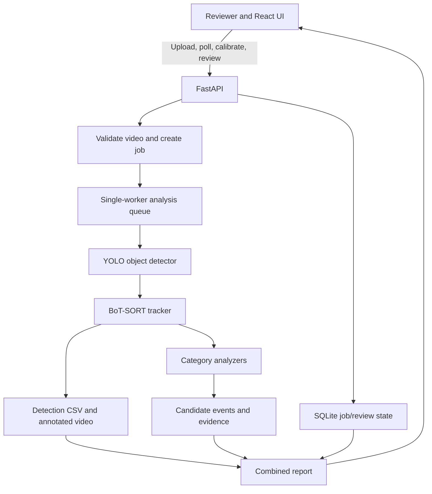

# Academic presentation material

This material is a fact-grounded starting point for slides and the written
report. Retain the implementation status and limitations; do not present
heuristic candidates as verified violations.

## Abstract

RoadSentinel is a local road-scene video review prototype intended to help a
human reviewer examine dashcam or CCTV footage. The application combines a
React and TypeScript interface with a FastAPI backend. Uploaded video is
validated, processed frame by frame using an Ultralytics YOLO object detector,
and tracked using BoT-SORT. The backend creates annotated playback, detection
records, candidate event data, and evidence linked to timestamps where
available. A combined report presents six road-safety categories with explicit
states for detected candidates, no candidates, missing calibration,
unavailable analysis, failures, or incomplete processing.

The configured IDD object detector does not directly recognize violation
labels. Some categories use experimental image-space heuristics; parking and
wrong-way analysis require camera-specific calibration; helmet analysis
requires an optional specialist checkpoint; goods-vehicle load-risk analysis
is unavailable. Therefore, the system is designed as a review aid rather
than an autonomous enforcement or legal-decision system. A recorded
end-to-end sample run completed 1,022 frames and generated detections,
candidate records, and evidence. These pipeline results demonstrate operation
on the tested clip only and are not an accuracy or generalization evaluation.

## Problem statement

Reviewing long road-camera recordings requires people to locate road users and
potentially relevant moments manually. The project explores whether local
object detection, tracking, rule-based candidate analysis, and timestamped
evidence can make video review easier while communicating uncertainty and
missing capabilities.

## Objectives

1. Provide local video upload and asynchronous processing.
2. Detect and track object classes supported by the configured model.
3. Generate annotated playback, detection exports, and event evidence.
4. Implement conservative candidate analysis where the available data and
   calibration permit it.
5. Show all six requested categories and their actual analysis status.
6. Preserve human review and avoid claiming legal certainty.

## Existing and proposed systems

### Existing workflow

The baseline for this project is manual inspection of recorded video and
general-purpose object detection/tracking. An object detection alone does not
identify the legal meaning of a scene or establish a violation.

### Proposed RoadSentinel workflow

RoadSentinel adds a local web interface, upload validation, YOLO detection,
BoT-SORT tracking, selected event heuristics, evidence generation, a combined
six-category report, and reviewer decisions. Missing specialists or
calibration are shown as unavailable or unconfigured rather than silently
represented as a clean analysis.

## Methodology

1. **Input:** Reviewer uploads an MP4, AVI, MOV, MKV, or WEBM video (maximum
   1 GB).
2. **Validation:** The backend checks the extension, size, and ability to
   decode a frame.
3. **Detection:** The configured YOLO checkpoint runs inference on frames.
4. **Tracking:** BoT-SORT associates detections across frames; IDs may switch
   or disappear under occlusion.
5. **Analysis:** Available category analyzers consume detections/tracks and
   optional user calibration. Some use experimental spatial/temporal rules.
6. **Evidence:** OpenCV produces annotated playback; event records reference
   timestamps and evidence when those are available.
7. **Reporting:** The API combines events and per-category status.
8. **Human review:** Reviewer inspects original/annotated footage and evidence
   and may record a decision.

## System architecture

See [ARCHITECTURE.md](ARCHITECTURE.md) for module and API details.

## Technology stack

- **Frontend:** React 18, TypeScript, Vite, `lucide-react`.
- **Backend:** Python, FastAPI, Uvicorn.
- **Computer vision:** OpenCV, Ultralytics YOLO, BoT-SORT tracker, PyTorch.
- **Storage:** SQLite, JSON, CSV, and local video/evidence files.
- **Testing:** Python `unittest`; frontend TypeScript check and Vite production
  build.

## Dataset and model

The processed IDD/YOLO dataset and its YAML are external to this repository:
`D:\RoadSentinel-Datasets\processed\IDD_YOLO` and
`D:\RoadSentinel-Datasets\processed\IDD_YOLO\idd.yaml`. Dataset image counts,
split counts, preprocessing manifest, and redistribution license are not
recorded in this repository; verify them from the dataset source before
including them in the final submission. The recorded class map contains 15
road-scene object classes: motorcycle, rider, car, person, autorickshaw,
truck, vehicle fallback, bus, traffic sign, animal, traffic light, bicycle,
caravan, train, and trailer.

The backend baseline is the YOLOv8n checkpoint
`D:\RoadSentinel-Datasets\training-runs\idd_yolov8n_full\weights\best.pt`.
The original is retained and the backend does not automatically replace it.
The general IDD checkpoint has no helmet, parking, triple-riding, pedestrian
conflict, wrong-way, or legal-overload classes.

## Training and evaluation results

The saved IDD validation artifacts record:

| Checkpoint | Epoch recorded | Precision | Recall | mAP@0.5 | mAP@0.5:0.95 |
| --- | ---: | ---: | ---: | ---: | ---: |
| `idd_yolov8n_full` baseline | 10/10 | 0.61192 | 0.26038 | 0.28612 | 0.18102 |
| `idd_yolov8n_finetune_50ep_20261103` | 11/50 planned | 0.63944 | 0.26263 | 0.29318 | 0.18473 |

These are dataset validation metrics from saved run artifacts, not independent
real-world tests or violation-classification scores. The fine-tune metrics
are modestly higher but its run is partial and its effective configuration
differs; this is insufficient evidence to promote it. The original checkpoint
remains the configured baseline.

The baseline saved PR curve reports per-class AP@0.5:

| Class | AP@0.5 | Class | AP@0.5 | Class | AP@0.5 |
| --- | ---: | --- | ---: | --- | ---: |
| motorcycle | 0.559 | rider | 0.462 | car | 0.580 |
| person | 0.400 | autorickshaw | 0.570 | truck | 0.501 |
| vehicle fallback | 0.038 | bus | 0.598 | traffic sign | 0.194 |
| animal | 0.136 | traffic light | 0.056 | bicycle | 0.199 |
| caravan | 0.000 | train | 0.000 | trailer | 0.000 |

Values were transcribed from the saved PR-curve legend. Validation support
counts are unavailable. A zero AP value does not establish that a class has
no examples or can never be detected.

## System results and verification

- Automated backend suite: 55 tests passed in the documented validation run.
- Frontend: TypeScript project check and Vite production build passed.
- Live integration: backend health and frontend/API connectivity succeeded;
  completed upload jobs and six-category report/evidence were inspected.
- One recorded sample run processed 1,022 of 1,022 frames, with 3,902
  detection rows, 139 unique track IDs, 22 raw candidate-event records, and
  22 evidence images.
- A historical `road_video.mp4` report showed 89 unsafe pedestrian interaction
  candidates; replaying its saved detections with the updated movement filter
  produced 60 candidates. Neither count is ground-truth accuracy evidence. They are experimental image-space
  candidates, not 89 confirmed violations.
- A separate single end-to-end run recorded 1,170 frames at 960-pixel input
  size and approximately 151.7 seconds (about 7.7 frames/second including
  tracking, output encoding, and event/evidence work). This is one run, not a
  repeatable performance benchmark.

No independent annotation-based real-world evaluation, raw false-positive or
false-negative count, violation precision/recall, calibrated physical
distance, or collision-probability evaluation is available.

## Implemented versus incomplete category status

| Category | Classification for presentation |
| --- | --- |
| Helmetless riding | Optional specialist model integration with primary-detector `rider` corroboration; unavailable without compatible weights. Saved-detection replay rejected five uncorroborated candidates in one clip, but there is no ground-truth accuracy validation. |
| Triple riding | Experimental rule-based candidate heuristic; not validated as a legal detector. |
| Restricted-zone parking | Calibration-based analyzer; requires a user-defined restricted zone and duration. |
| Goods-vehicle load risk | Not implemented as a validated visual analyzer; report explicitly states unavailable. |
| Unsafe pedestrian interaction | Experimental image-space interaction heuristic requiring pedestrian movement and closing proximity; the report labels the pedestrian as subject and vehicle as context. Saved-detection replay reduced target-video candidates from 8 to 2, without ground-truth validation. |
| Wrong-way movement | Calibration-based track-direction analyzer; requires user-defined road region and expected direction. |

## Limitations

- IDD object classes do not equal violation labels.
- Far objects, occlusion, lighting, camera placement, and track identity
  switches can affect outcomes.
- Triple-riding and pedestrian/vehicle interaction thresholds are
  experimental; they may produce false candidates or miss events.
- Parking and wrong-way analysis depend on calibration quality.
- Helmet detection requires a dedicated compatible model; its model scores
  are not calibrated probabilities and no independent benchmark was
  performed.
- No cargo load/weight or legal overloading determination is available.
- Pixel distances and displacements are not calibrated physical measurements.
- The process does not resume a video job after backend interruption.

## Future scope

Priorities are to obtain appropriately licensed violation-specific annotated
data, define expert-reviewed ground truth, evaluate each category with
independent precision/recall and false-positive/negative analysis, validate
across cameras/weather, add camera calibration where physical measurements
are required, and assess specialist helmet/cargo models before making
operational claims.
