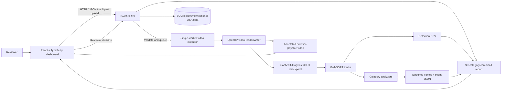

# RoadSentinel architecture

## System context

RoadSentinel is a local video-analysis and human-review application. The React
dashboard communicates with a FastAPI service over HTTP. The API validates
uploads, schedules analysis, serves job state and evidence, and builds the
combined report. Video files, derived artifacts, and SQLite records are stored
on the machine running the backend.

## Components

### Frontend

`frontend/src/` contains the Vite application, dashboard, video upload and job
progress UI, annotated playback, event timeline, report dialog, evidence
interaction, and parking/direction calibration components. It calls the API
using `VITE_API_BASE_URL`. The UI polls job status and displays report category
states rather than treating an empty category as proof that no violation
occurred.

Important components:

- `frontend/src/App.tsx` — dashboard, job selection, upload, processing state,
  video/event review, and API interaction.
- `frontend/src/components/VideoJobReport.tsx` — per-job report categories,
  event details, evidence, and report status.
- `frontend/src/components/ParkingZoneCalibrator.tsx` — restricted-zone
  calibration UI.
- `frontend/src/components/RoadDirectionCalibrator.tsx` — road-region and
  expected-direction calibration UI.

### FastAPI backend and job lifecycle

`api.py` exposes health, summary, event, upload, job, report, evidence, export,
calibration, review, and optional AI routes. Upload handling restricts file
extensions, enforces a 1 GB limit, creates a generated server-side filename,
and verifies that OpenCV can decode the video before queueing work.

Video work is submitted to a single-worker executor and guarded by an analysis
lock. This keeps model inference serialized and API requests responsive while
one job runs. Job metadata is periodically persisted to
`outputs/video_jobs.sqlite3`; after a restart, in-progress jobs are marked
failed rather than resumed. YOLO weights are cached by model identity, while
per-video predictor/tracker state is reset.

### Detection and tracking

The configured Ultralytics YOLO checkpoint detects object classes in source
frames. The general detector uses the checkpoint's own classes; its IDD class
map contains road objects such as motorcycle, rider, car, person, and truck.
It does not directly output helmet state, triple-riding, parking, wrong-way,
pedestrian-conflict, or legal-overloading labels.

The backend runs tracking using the configured Ultralytics tracker (default
`botsort.yaml`) and selected confidence/image-size settings. Track IDs and
image-space motion are useful signals but can be wrong under occlusion,
overlap, or perspective changes. Device, checkpoint, class names, and key
inference settings are recorded in job metadata when available.

### Event analyzers

Analyzers consume detections/tracks and category-specific configuration:

| Module | Responsibility |
| --- | --- |
| `tools/roadsentinel_candidate_event_analyzer.py` | General tracked-object observations and candidate support data |
| `tools/roadsentinel_helmet_analyzer.py` | Optional explicit helmet-state model validation/association and sustained candidate logic; specialist rider boxes must overlap a same-frame primary-detector `rider` box before an event is emitted |
| `tools/roadsentinel_interaction_analyzer.py` | Experimental motorcycle/rider association and pedestrian/vehicle interaction heuristics; pedestrian candidates require person-track movement and report the pedestrian as the primary subject |
| `tools/roadsentinel_parking_event_analyzer.py` | Stationary vehicle analysis against a configured restricted zone |
| `tools/roadsentinel_directional_event_analyzer.py` | Track direction analysis against a configured road region and expected direction |

The helmet specialist model is separate and optional. Parking and wrong-way
analysis require reviewer-provided camera calibration. The goods-vehicle
category is explicitly reported unavailable because no validated cargo-risk
analysis model is configured. Analyzer output is a review candidate, not an
automated legal conclusion.

### Evidence and persistence

OpenCV reads the source video and writes annotated playback. Event-generation
code associates saved event records with source-video timestamps/frame
numbers and evidence paths when those values exist. The app serves annotated
videos and evidence through local API static routes.

Runtime data is under `outputs/`:

- `video_jobs/` — uploaded/processed jobs, detections, summaries, category
  records, and event evidence.
- `video_jobs.sqlite3` — job metadata and progress.
- `review_decisions.sqlite3` — reviewer decisions and decision history.
- `ai_qa.sqlite3` — optional AI Q&A history.

These are local generated files and are ignored by Git. Back up files needed
for an evaluation separately; do not assume the runtime directory is source
control or a long-term archive.

### Combined report and review

`GET /api/v1/videos/jobs/{job_id}/report` aggregates saved job information,
review-aware events, category analysis outcomes, status, and limitations. The
report presents all six categories even when they have zero events or analysis
is unavailable.

Statuses communicate different states:

- `events_detected` — one or more review candidates were produced.
- `no_events` — configured analysis completed but no candidate met its rules.
- `not_configured` — required calibration is missing.
- `analysis_unavailable` — required specialist capability is absent.
- `analysis_failed` — processing this category failed.
- `processing_incomplete` — job or category processing has not completed.

Event timestamps can be selected in the UI to seek annotated playback and open
evidence. Review decisions are stored separately and do not rewrite the
original detection as ground truth.

Optional AI summary, Q&A, and event explanation features are user-triggered.
Their configured provider receives structured event data, not source video or
evidence frames. AI text is explanatory and cannot confirm a violation.

## Key API routes

| Route | Role |
| --- | --- |
| `GET /health` | Readiness and configured model state |
| `POST /api/v1/videos/upload` | Validate and queue a video |
| `GET /api/v1/videos/jobs` | List jobs |
| `GET /api/v1/videos/jobs/{job_id}` | Poll job state/progress |
| `GET /api/v1/videos/jobs/{job_id}/events` | Read category events/outcomes |
| `GET /api/v1/videos/jobs/{job_id}/report` | Read combined report |
| `POST /api/v1/videos/jobs/{job_id}/parking-analysis` | Run calibrated parking analysis |
| `POST /api/v1/videos/jobs/{job_id}/direction-calibration` | Run calibrated direction analysis |
| `POST /api/v1/review-decisions` | Save a reviewer decision |

Use the running service's `/docs` page for current request and response schemas.
