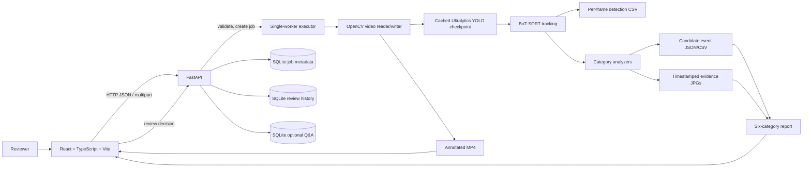
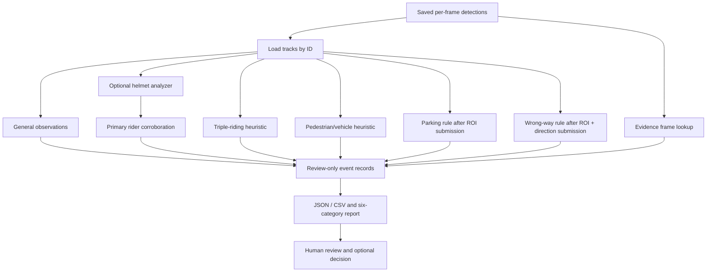

# RoadSentinel Project Facts

**Evidence-based extraction for IEEE report and presentation preparation**  
**Repository:** `C:\Users\Admin\Desktop\BTECH\RoadSentinel`  
**Extraction date:** 2026-11-05  
**Scope:** Read-only project audit plus creation of this facts document. No model was trained and no application source, dataset, checkpoint, or existing output was changed for this extraction.

## How to read this document

- **Verified in repository/runtime** means the claim was checked against source code, a checked-in or external artifact, saved output, or a command executed during this extraction.
- **Saved result** means a result was read from an existing job/training artifact. It does not imply the run was repeated now.
- **Analyzer replay** means saved detections were passed through the changed candidate-analysis functions. It is not a new YOLO inference pass or a ground-truth evaluation.
- **Unavailable** means the required measurement, artifact, or implementation could not be established. It is not a zero value.
- **Candidate** and **observation** are used literally. Neither term means a legally confirmed violation.

Unless stated otherwise, source paths in tables are relative to the repository root. Dataset and training files live outside the repository on `D:\RoadSentinel-Datasets`.

## 1. Project information

### Project name and abstract

**Full project name:** RoadSentinel — a local road-scene video analysis and human-review application. The API identifies itself as “RoadSentinel API”, version `0.2.0`; the frontend package version is `0.1.0`.

**Abstract.** RoadSentinel is a local web application for reviewing road-scene video. A React and TypeScript frontend sends uploaded footage to a FastAPI backend. The backend validates the video, uses an Ultralytics YOLO object detector and BoT-SORT tracking to record supported road-user detections, and creates annotated playback, detection data, timestamped evidence, and a review-oriented report. The report represents six requested safety categories, but their analysis is not uniform: helmet analysis depends on an optional specialist model and primary-detector corroboration; triple-riding and pedestrian/vehicle interaction use experimental image-space heuristics; parking and wrong-way analysis require camera-specific user calibration; and goods-vehicle overloading has no configured analyzer. Automated candidates are not legal findings and require human review.

**Abstract evidence:** `README.md`; `docs/ARCHITECTURE.md`; `api.py`; `tools/roadsentinel_interaction_analyzer.py`; `tools/roadsentinel_helmet_analyzer.py`.

### Problem, motivation, objectives, proposed solution

Manual inspection of long dashcam or CCTV recordings takes time and makes it difficult to find relevant moments consistently. A general object detector can locate road users, but it does not independently establish behavior, context, or a legal violation. The project explores whether local object detection, tracking, timestamped evidence, selective rule-based screening, and human review can make video review easier without overstating what the model knows.

Project objectives, as evidenced by the implementation and documentation:

1. Accept supported road-scene videos and reject empty, unsupported, oversized, or unreadable uploads.
2. Detect and track supported object classes using the configured checkpoint.
3. Generate annotated playback, detection exports, and frame-based evidence.
4. Run only the event analyzers for which inputs, specialist models, or calibration are present.
5. Present a state and explanation for each of the six report categories.
6. Let a reviewer inspect evidence, seek the video, and store a review decision/history.
7. Distinguish missing, failed, unconfigured, and no-candidate analyses from positive candidates.

**Proposed advantages:** one browser workflow for upload, progress, playback, event review, calibration, evidence, and reporting; local video/model processing; traceable timestamps and evidence; and explicit uncertainty/status handling. These are workflow advantages, not claims of improved violation-detection accuracy.

### Existing workflow, users, use cases, and scope

- **Existing workflow represented in project docs:** a reviewer watches road-camera footage manually, possibly assisted by object detections. The detector alone does not interpret legal behavior.
- **Intended users:** the repository does not formally specify a user-requirements study or deployed customer. The implemented interface is for a human video reviewer/operator; academic demonstration and prototype evaluation are the substantiated contexts.
- **Potential applications:** locating road-scene objects and candidate moments in recorded CCTV/dashcam footage for later review. The code does not establish suitability for autonomous enforcement, live citywide monitoring, legal adjudication, or emergency response.
- **Exact implementation scope:** local web app; uploaded video; YOLO road-object detection; BoT-SORT tracks; selected event heuristics and calibration tools; evidence and report generation; optional structured-data AI text features; reviewer decisions.
- **Out of scope/unavailable:** direct legal determination, automatic ticketing, calibrated physical speed/distance or time-to-collision, verified cargo weight/overload inference, and six-category ground-truth performance guarantees.

## 2. Complete feature inventory

| Feature | Actual implementation and workflow | Backend/API | Frontend | Test or saved evidence | Status and limitations |
|---|---|---|---|---|---|
| Dashboard and readiness | Shows global summary, events, jobs, API/model readiness, filters, and pagination. | `GET /health`, `/api/v1/summary`, `/api/v1/events`, `/api/v1/videos/jobs` | `frontend/src/App.tsx` | API workflow tests cover readiness and report paths; prior saved browser/job checks are documented in `README.md`. | Implemented. Displayed counts are observations/candidates, not accuracy metrics. |
| Video upload validation | Multipart file; allowed suffixes MP4/AVI/MOV/MKV/WEBM; max 1,000,000,000 bytes; nonempty; OpenCV must open and decode a frame; generated server filename uses job ID and sanitized stem. | `POST /api/v1/videos/upload` | Upload controls in `App.tsx` | `test_upload_rejects_unreadable_video_and_removes_temporary_file`; `test_upload_accepts_validated_video_and_uses_safe_generated_filename`; missing-model test. | Implemented and unit-tested. A successful response means queued, not analysis completed. |
| Background processing/job progress | Single-worker executor serializes video work; status/stage/progress persist in SQLite; UI polls job endpoint every 2 seconds. | `GET /api/v1/videos/jobs`, `GET /api/v1/videos/jobs/{job_id}` | `App.tsx` | Tests include job restart behavior and failure conditions; saved job JSON/SQLite records exist. | Implemented. In-progress work is marked failed on restart rather than resumed. |
| Model loading and caching | Baseline YOLO weights cached by resolved path/mtime/size; per-video predictor/tracker state reset. CUDA device 0 used when `torch.cuda.is_available()`, otherwise CPU. | Used within upload job processing | Not directly exposed beyond state/report | Model cache and inference configuration API tests; job summaries record versions/device when available. | Implemented. Runtime speed/VRAM vary by device and video. |
| Road object detection | `model.track(..., stream=True, persist=True)` returns classes, confidence, boxes and IDs; per-frame detections are saved to CSV. | Video upload job | Annotated playback and detection/event views in `App.tsx` | Archived real-video summaries; detector is not evaluated against violation labels. | Implemented for the checkpoint's classes. Detection errors and domain shift remain. |
| Object tracking | Ultralytics tracker configured by `botsort.yaml` default; `bytetrack.yaml` is also accepted. Track IDs support temporal event logic. | Video upload job | Track IDs shown in events/details | Synthetic analyzer tests and archived tracking studies. | Implemented; IDs can switch, fragment, or be inconsistent. |
| Annotated video | OpenCV reads frames, draws boxes/labels, and writes MP4 output; job provides a processed-video URL. | Static route `/processed-videos/...` | Video player in `App.tsx` | Saved annotated MP4 artifacts for completed jobs. | Implemented. Codec/browser support depends on source/runtime. |
| Detection CSV and event export | Detection rows and event records saved; job event exports are CSV/JSON; global event exports also exist. | `GET /api/v1/videos/jobs/{job_id}/events.csv`, `.json`; global report CSV/JSON routes | Download controls in dashboard/report | API tests exercise candidate/report payloads and exports. | Implemented; export records can include review metadata. |
| Candidate event analysis | General track observations plus category-specific heuristics. | Built into job processing; parking/direction are separate post-processing routes. | Event timeline, table and report | Analyzer/API unit tests. | Implemented with differing category maturity; see Section 8. |
| Timestamp seek and event evidence | Events store timestamp/frame; evidence generation reopens source video at event frame and draws participant boxes/labels. | Job events/report and static `/job-evidence/...` | Timeline, report links, selected-event detail in `App.tsx` and `VideoJobReport.tsx` | Evidence generation tests; saved evidence JPGs. | Implemented. Frame/timestamp values depend on source FPS and decoder metadata. |
| Six-category report | Aggregates events, reviewer status, category state/message, errors, and limitations; differentiates no-events, failed, unavailable, not-configured, incomplete, and events-detected. | `GET /api/v1/videos/jobs/{job_id}/report` | `VideoJobReport.tsx` | Extensive API report tests; saved reports. | Implemented as a reporting surface; category inclusion does not imply a functioning detector for every category. |
| Parking calibration | Selects normalized polygon and stationary-duration setting. Backend tests bottom-center inclusion, stationarity, confidence and time continuity. | `GET .../calibration-frame`; `POST .../parking-analysis` | `ParkingZoneCalibrator.tsx` | Positive/negative synthetic tests; saved calibrated job had zero parking-zone candidates. | Implemented but camera-specific and not legally decisive. |
| Direction calibration | User draws road polygon and expected direction arrow; tracks in ROI are compared with the direction vector. | `GET .../calibration-frame`; `POST .../direction-calibration` | `RoadDirectionCalibrator.tsx` | Synthetic/API tests; an archived calibrated run generated three candidate records. | Implemented but perspective-sensitive and not ground-truth validated. |
| Human review and audit history | Saves status/reviewer/note with history in a separate SQLite store. | `POST /api/v1/review-decisions`, `GET` decisions, CSV export | Event detail/review panel in `App.tsx` | API workflow tests include review/report preservation. | Implemented. Reviewer confirmation is a human decision, not model confidence. |
| Optional AI summary | Summarizes structured event records into an executive summary, patterns, events to review, reviewed events and limitations. Remote call is optional; deterministic local fallback exists. | `POST /api/v1/videos/jobs/{job_id}/ai-summary`; download routes | Controls in `App.tsx` | API tests check instructions/structured output; saved AI explanation artifact exists (not necessarily summary). | Implemented conditionally; does not view video frames. |
| Optional AI event explanation | Generates structured explanation, supporting facts, uncertainty and reviewer guidance for one event. | `POST .../events/{event_id}/ai-explanation`; download route | Event modal in `App.tsx` | Mocked/workflow tests and saved JSON artifact. | Implemented conditionally. Not independent visual verification; remote failure can silently fall back to deterministic local text. |
| Optional video-job Q&A | Questions are answered using up to 100 prioritized structured events and up to 8 prior turns; citations are validated against known event IDs. | `POST .../questions`, `GET .../questions` | Q&A panel in `App.tsx` | Tests cover citation filtering and insufficient-data answers. | Implemented with optional remote LLM and local rule/template fallback. No video frames or evidence images are supplied. |
| Offline dataset/tracker experiments | Dataset conversion/audit scripts, tracker comparisons, track stability and trajectory diagnostics exist under `tools/`, `experiments/`, and `outputs/`. | Not exposed as app API | Not part of dashboard workflow | Reports and CSVs saved under `outputs/tracking_parameter_study_20261030` and `outputs/trajectory_analysis_20261030`. | Research/diagnostic tooling, not production user-facing analytics; lacks ground-truth identity labels. |

### Project directories and important files

- `api.py` — FastAPI routes, upload validation, job queue, inference, artifacts, categories, report, AI, and review.
- `tools/roadsentinel_candidate_event_analyzer.py` — track/event support and general movement/stationary observations.
- `tools/roadsentinel_helmet_analyzer.py` — optional helmet-specific association and sustained candidate logic.
- `tools/roadsentinel_interaction_analyzer.py` — triple-riding and pedestrian/vehicle heuristics.
- `tools/roadsentinel_parking_event_analyzer.py` — calibrated parking-zone rule.
- `tools/roadsentinel_directional_event_analyzer.py` — calibrated wrong-way rule.
- `tools/roadsentinel_local_wllm.py` — deterministic local fallback for structured summary, explanation, and Q&A.
- `tools/dataset/prepare_idd.py` — conversion of VOC XML boxes to YOLO text labels and dataset YAML.
- `train_idd_finetune.py`, `tools/dataset/train_idd.py` — training entry points.
- `src/video_detector.py`, `tools/track_roadsentinel.py` — earlier/standalone detection and tracking scripts; not the main FastAPI execution path.
- `tests/` — five unittest modules.
- `frontend/src/App.tsx` and `frontend/src/components/` — dashboard and UI components.
- `outputs/` — local generated data and validation/experiment records; do not treat all artifacts as source files.

## 3. Exact technology stack and environment

Versions below are **installed versions observed in the named environment on 2026-11-05**, not all dependency-manifest requirements.

### Frontend

| Component | Installed version | Manifest range/version |
|---|---:|---|
| Node.js | 24.22.1 | Not pinned by package manifest; README recommends Node 20.19+ or 22.12+. |
| npm | 11.19.1 | Not pinned. |
| React | 18.3.1 | `^18.3.1` |
| React DOM | 18.3.1 | `^18.3.1` |
| TypeScript | 5.9.3 | `^5.7.2` |
| Vite | 6.4.5 | `^6.0.5` |
| `@vitejs/plugin-react` | 4.7.0 | `^4.3.4` |
| `lucide-react` | 0.468.0 | `^0.468.0` |
| `@types/react` | 18.3.31 | `^18.3.12` |
| `@types/react-dom` | 18.3.7 | `^18.3.1` |

Evidence: `frontend/package.json`, `frontend/package-lock.json`, `node --version`, `npm --version`, `npm list --depth=0`.

### Backend Python packages

| Package | Installed version | Manifest |
|---|---:|---|
| Python | 3.12.10 | Not pinned in `requirements.txt`; environment executable `C:\Projects\RoadSentinel\.venv\Scripts\python.exe` |
| FastAPI | 0.162.0 | Unpinned |
| Uvicorn | 0.54.0 | `uvicorn[standard]`, unpinned |
| OpenCV (`opencv-python`) | 4.14.0.94 | `>=4.10,<5` |
| PyTorch | 2.13.0+cu126 | Not pinned in `requirements.txt`; install an appropriate build separately |
| Ultralytics | 8.4.187 | `>=8.3.0` |
| NumPy | 2.2.6 | `<2.3` |
| pandas | 2.3.3 | `>=2.2,<3` |
| httpx | 0.28.1 | Unpinned |
| python-multipart | 0.0.32 | Unpinned |
| imageio-ffmpeg | 0.6.0 | Unpinned |
| Starlette | Not captured in installed-version probe | Listed unpinned |
| huggingface_hub | Not captured in installed-version probe | `>=0.24.0` |

Evidence: `requirements.txt`; `importlib.metadata` probe executed using the project venv. Version ranges in the manifest are not exact lock pins.

### Hardware and runtime

| Item | Observed value |
|---|---|
| OS | Windows 11, build reported as `10.0.26300`, 64-bit |
| CPU | AMD Ryzen 7 6800H with Radeon Graphics; 8 cores / 16 logical processors |
| Installed RAM | 16,371,519,488 bytes (about 15.25 GiB) |
| GPU | NVIDIA GeForce RTX 3050 Ti Laptop GPU |
| GPU memory | 4,294,440,960 bytes (4 GiB) |
| NVIDIA driver | 621.01 (`nvidia-smi`) |
| PyTorch CUDA build | 12.6 (`2.13.0+cu126`) |
| CUDA availability | `torch.cuda.is_available() == True` at extraction |
| Runtime device in saved job `1ab59b37bda6` | CUDA GPU, RTX 3050 Ti Laptop GPU |

This is the observed development machine, not a minimum system requirement or a guarantee of inference speed.

### Startup ports and commands

README documents using alternate ports because older processes occupy the defaults:

**Backend, from repository root (Command Prompt):**

```bat
cd /d C:\Users\Admin\Desktop\BTECH\RoadSentinel
C:\Projects\RoadSentinel\.venv\Scripts\python.exe -m uvicorn api:app --host 127.0.0.1 --port 8766
```

**Frontend, second terminal:**

```bat
cd /d C:\Users\Admin\Desktop\BTECH\RoadSentinel\frontend
npm ci
set "VITE_API_BASE_URL=http://127.0.0.1:8766"
npm run dev -- --port 5174
```

The browser URL is `http://127.0.0.1:5174/`; API health/docs are `http://127.0.0.1:8766/health` and `/docs`. CORS allowlist in `api.py` includes localhost and 127.0.0.1 on 5174. `frontend/src/App.tsx` otherwise defaults API URL to port 8000; the documented environment override is therefore material. The README says 8765 and 5173 are occupied and should not be terminated without identification. `run_demo.bat` still names 8765 and should not be mistaken for the documented alternate-port startup path.

Build command in frontend directory: `npm run build` (in this Windows PowerShell environment, `npm.cmd run build` was used to avoid the PowerShell script execution-policy restriction).

## 4. Dataset details

### What is established

- **Upstream dataset:** India Driving Dataset (IDD), developed for road-scene understanding in unstructured Indian driving environments. The official IDD site describes 10,000 images; the paper reports 10,004 images, 34 classes, and 182 drive sequences.
- **Processed dataset configured for this project:** `D:\RoadSentinel-Datasets\processed\IDD_YOLO`.
- **Dataset YAML:** `D:\RoadSentinel-Datasets\processed\IDD_YOLO\idd.yaml`.
- **Raw conversion input specified in code:** `D:\RoadSentinel-Datasets\raw\IDD_Detection`.
- **Configured splits:** `images/train` and `images/val`; there is no `test:` split in the YAML.
- **Project class map:** 15 classes listed below, a subset/alternate detection mapping rather than the upstream dataset’s full 34-class label set.
- **Conversion format:** VOC XML bounding boxes are clipped to image bounds, converted to normalized YOLO detection rows (`class_id x_center y_center width height`), and images are copied. The converter writes a YAML with 15 names and converts `train` and `val`.
- **Training augmentation settings in baseline run args:** HSV hue/saturation/value; scale and translation; horizontal flip; mosaic; RandAugment setting and random erasing are enabled/configured in Ultralytics args. No separate project-owned image normalization or physical camera rectification is described by the converter.

### Project class map

| Class ID | Class name |
|---:|---|
| 0 | motorcycle |
| 1 | rider |
| 2 | car |
| 3 | person |
| 4 | autorickshaw |
| 5 | truck |
| 6 | vehicle fallback |
| 7 | bus |
| 8 | traffic sign |
| 9 | animal |
| 10 | traffic light |
| 11 | bicycle |
| 12 | caravan |
| 13 | train |
| 14 | trailer |

Source: `idd.yaml`, `tools/dataset/prepare_idd.py`, and job metadata `model_class_names`.

### Unknown or not established

The repository does not provide a checked split manifest with image counts, a project-specific class-distribution report, a reproducible dataset-size total, or a verified redistribution/license notice for the external processed copy. A recursive count was not completed during this extraction. Do not copy upstream “10,004 images / 34 classes” into the project-subset count fields: those refer to the upstream IDD paper, not necessarily the locally processed 15-class split.

The conversion script records `train_errors.txt` and `val_errors.txt` if conversions fail, but this extraction did not establish the final train/validation sample counts or use those error lists as a complete preprocessing audit. Confirm source attribution and licensing with the dataset source before redistribution or publication.

## 5. Model and training details

### Currently configured model

- **Model family/variant:** Ultralytics YOLOv8n object-detection model, initialized for the baseline training run from `yolov8n.pt`.
- **Checkpoint used by FastAPI by default:** `D:\RoadSentinel-Datasets\training-runs\idd_yolov8n_full\weights\best.pt`.
- **Runtime override:** `ROAD_SENTINEL_MODEL_PATH`.
- **Baseline run:** `idd_yolov8n_full`, 10 recorded epochs.
- **Optional helmet checkpoint default:** `D:\RoadSentinel-Datasets\models\helmet_violation_apache_best.pt`; it is loaded separately and only when its class contract is valid.
- **Model class names:** the 15 project classes in Section 4. These are road-object categories, not violation labels.
- **Backend inference configuration in saved job `1ab59b37bda6`:** confidence 0.45, image size 960, `botsort.yaml`, CUDA GPU. API code defaults to confidence 0.45 and image size 960; `.env.example` contains a confidence override of 0.35, so the effective setting depends on `.env`.
- **Device selection:** CUDA device 0 when available, otherwise `"cpu"`.
- **Caching:** baseline and specialist model weights are cached; predictor state is reset between video jobs.

The serialized checkpoint is external to this repository. This facts extraction does not inspect or claim a full neural-network layer-by-layer architecture beyond the YOLOv8n family indicated by the run/checkpoint and Ultralytics setup.

### Baseline training configuration (`idd_yolov8n_full/args.yaml`)

| Parameter | Recorded value |
|---|---|
| Initial model | `yolov8n.pt` |
| Dataset YAML | `D:\RoadSentinel-Datasets\processed\IDD_YOLO\idd.yaml` |
| Task | detection |
| Epochs | 10 |
| Batch | 2 |
| Image size | 640 |
| Device | GPU `0` |
| Optimizer | `auto` |
| `lr0` / `lrf` | 0.01 / 0.01 |
| Cosine LR | false |
| Warmup | 3 epochs |
| Patience | 5 |
| Pretrained | true |
| AMP | true |
| Validation | true, split `val` |
| Seed/deterministic | 0 / true |
| Workers | 0 |
| Fraction | 1.0 |
| Augmentation highlights | HSV, translation, scale, horizontal flip, mosaic; exact values in run `args.yaml` |

### Additional training runs and promotion status

| Run | Artifacts | Recorded status | Backend use |
|---|---|---|---|
| `idd_yolov8n_full` | args, results.csv, best/last checkpoints, curves, confusion matrices, validation/train preview images | Baseline; 10/10 epochs with validation. | **Currently configured default.** |
| `idd_yolov8n_finetune_50ep_20261103` | args, results.csv, best/last checkpoints, train preview images | Results contain 11 epochs of a planned 50. It is a partial run. Actual saved args show resume from its `last.pt`, optimizer `MuSGD`, `lr0=0.01`; `train_idd_finetune.py` requests `lr0=0.001`, `optimizer` default, and a new 50-epoch run. These artifacts are not identical configurations. | Not promoted; backend continues to point to baseline. |
| `idd_yolov8n_smoke` | args, one-epoch results, best/last checkpoints | Smoke run, fraction 0.01, validation disabled in args; not a comparable evaluation. | Not configured. |

Do not select a model merely because a checkpoint is newer. The configured baseline is `best.pt` in `idd_yolov8n_full`. The fine-tune checkpoint is experimental and not promoted.

### Recorded epoch metrics (each run kept separate)

The following are exact rows from the respective `results.csv` files. P/R/mAP columns are reported by the training framework for the run’s validation step where validation was enabled. They are **object-detection metrics on the configured validation split**, not traffic-violation performance. Loss units and framework meanings follow Ultralytics.

#### Baseline `idd_yolov8n_full` (`D:\RoadSentinel-Datasets\training-runs\idd_yolov8n_full\results.csv`)

| Epoch | Time s (cumulative) | Train box | Train cls | Train DFL | Precision | Recall | mAP50 | mAP50–95 | Val box | Val cls | Val DFL |
|---:|---:|---:|---:|---:|---:|---:|---:|---:|---:|---:|---:|
| 1 | 3794.85 | 1.54043 | 1.64517 | 1.15200 | 0.50340 | 0.20840 | 0.22307 | 0.13706 | 1.56317 | 1.40907 | 1.08379 |
| 2 | 5812.09 | 1.51820 | 1.35886 | 1.14110 | 0.57949 | 0.21981 | 0.24253 | 0.15079 | 1.52304 | 1.31091 | 1.06670 |
| 3 | 8413.46 | 1.49858 | 1.29822 | 1.13221 | 0.47638 | 0.22533 | 0.24857 | 0.15428 | 1.50215 | 1.26998 | 1.06136 |
| 4 | 17188.20 | 1.47539 | 1.24578 | 1.11951 | 0.59002 | 0.23066 | 0.25401 | 0.15961 | 1.47866 | 1.21667 | 1.04667 |
| 5 | 19216.80 | 1.44351 | 1.18760 | 1.10033 | 0.59963 | 0.24051 | 0.26326 | 0.16464 | 1.47247 | 1.18990 | 1.04393 |
| 6 | 21238.70 | 1.41777 | 1.13653 | 1.08656 | 0.62171 | 0.24401 | 0.26903 | 0.16937 | 1.44417 | 1.14886 | 1.02714 |
| 7 | 23257.60 | 1.39441 | 1.10763 | 1.07237 | 0.61418 | 0.24993 | 0.27429 | 0.17210 | 1.43756 | 1.13076 | 1.02628 |
| 8 | 26385.80 | 1.36752 | 1.05750 | 1.06026 | 0.61707 | 0.25591 | 0.28087 | 0.17689 | 1.42523 | 1.11051 | 1.01798 |
| 9 | 28481.90 | 1.34485 | 1.01852 | 1.05225 | 0.61443 | 0.26010 | 0.28512 | 0.18000 | 1.41656 | 1.08864 | 1.01350 |
| 10 | 30494.80 | 1.32500 | 0.99044 | 1.04077 | 0.61192 | 0.26038 | 0.28612 | 0.18102 | 1.40766 | 1.07604 | 1.00772 |

#### Partial fine-tune `idd_yolov8n_finetune_50ep_20261103` (`results.csv`)

| Epoch | Time s (recorded) | Train box | Train cls | Train DFL | Precision | Recall | mAP50 | mAP50–95 | Val box | Val cls | Val DFL |
|---:|---:|---:|---:|---:|---:|---:|---:|---:|---:|---:|---:|
| 1 | 2207.67 | 1.37996 | 1.13591 | 1.10205 | 0.68418 | 0.23808 | 0.26617 | 0.16592 | 1.47451 | 1.18967 | 1.02960 |
| 2 | 4327.13 | 1.44631 | 1.24159 | 1.13008 | 0.60497 | 0.23036 | 0.25776 | 0.15868 | 1.50428 | 1.23951 | 1.04815 |
| 3 | 6424.74 | 1.51425 | 1.35091 | 1.16633 | 0.60833 | 0.22259 | 0.24623 | 0.15184 | 1.53371 | 1.30529 | 1.07047 |
| 4 | 2165.24 | 1.53198 | 1.36430 | 1.18058 | 0.57767 | 0.22526 | 0.25196 | 0.15560 | 1.52525 | 1.26489 | 1.07057 |
| 5 | 4273.49 | 1.49789 | 1.28832 | 1.16229 | 0.51552 | 0.23434 | 0.26536 | 0.16442 | 1.49904 | 1.21546 | 1.05445 |
| 6 | 2136.22 | 1.44837 | 1.21655 | 1.13811 | 0.49099 | 0.24667 | 0.26968 | 0.16790 | 1.47903 | 1.18003 | 1.04654 |
| 7 | 4304.48 | 1.43018 | 1.18436 | 1.12893 | 0.56672 | 0.24621 | 0.27654 | 0.17187 | 1.46122 | 1.16134 | 1.03952 |
| 8 | 6855.11 | 1.42900 | 1.18449 | 1.13055 | 0.63052 | 0.25325 | 0.28321 | 0.17725 | 1.44648 | 1.13728 | 1.03354 |
| 9 | 9010.13 | 1.41536 | 1.16130 | 1.12305 | 0.53064 | 0.25142 | 0.28615 | 0.17883 | 1.43613 | 1.12136 | 1.02868 |
| 10 | 11117.40 | 1.39818 | 1.13772 | 1.11579 | 0.63580 | 0.25602 | 0.28791 | 0.18084 | 1.42388 | 1.11012 | 1.02178 |
| 11 | 13256.40 | 1.39361 | 1.12500 | 1.11149 | 0.63944 | 0.26263 | 0.29318 | 0.18473 | 1.41561 | 1.09366 | 1.01807 |

The time column for the partial run resets across some rows, consistent with resumed training segments; do not sum it as a clean total duration.

#### Smoke run `idd_yolov8n_smoke`

One recorded epoch: train losses box/cls/DFL = `2.03851 / 7.94583 / 1.33888`; results CSV reports P/R/mAP50/mAP50–95 = `0.17085 / 0.10788 / 0.08260 / 0.05201`; validation losses = `1.73775 / 8.98805 / 1.20055`. Its saved args say `fraction=0.01` and `val=false`; treat these values as a smoke-run record, not a validated model benchmark.

### Other validation measurements

The checked-in-runtime `outputs/validation/confidence_threshold_summary.json` records results from the baseline checkpoint at two confidence settings:

| Confidence | Precision | Recall | mAP50 | mAP50–95 | Saved validation directory |
|---:|---:|---:|---:|---:|---|
| 0.25 | 0.5226233 | 0.2469817 | 0.2270308 | 0.1561980 | `outputs/validation/idd_yolov8n_full_conf25` |
| 0.35 | 0.5935155 | 0.2225633 | 0.2089893 | 0.1476306 | `outputs/validation/idd_yolov8n_full_conf35` |

These are object-detection validation results; they do not measure category analyzers. The saved baseline PR-curve legend was transcribed in `docs/ACADEMIC_PRESENTATION.md` as per-class AP@0.5: motorcycle 0.559, rider 0.462, car 0.580, person 0.400, autorickshaw 0.570, truck 0.501, vehicle fallback 0.038, bus 0.598, traffic sign 0.194, animal 0.136, traffic light 0.056, bicycle 0.199, caravan 0.000, train 0.000, trailer 0.000. Per-class support counts and per-class fine-tune AP are unavailable. A zero AP read from a plot is not proof that the class never occurs.

No separate untouched test-set result, independently labeled traffic-violation evaluation, category precision/recall, false-positive/negative study, or project-level test coverage report was found.

## 6. Video processing results

### Exact 1,022-frame run

The following values were independently checked in:

- `outputs/video_jobs/1ab59b37bda6_summary.json`
- `outputs/video_jobs/1ab59b37bda6_candidate_events.json`
- `outputs/video_jobs/1ab59b37bda6_detections.csv`
- `outputs/video_jobs.sqlite3`
- `outputs/uploads/1ab59b37bda6_correct_video.mp4`

| Field | Verified value |
|---|---|
| Original filename | `correct video.mp4` |
| Video metadata | 1280×720, 30 FPS, 1,022 frames, 34.0667 seconds |
| Processed frames | 1,022 |
| Detection rows | 3,902 |
| Unique track IDs | 139 |
| Evidence images | 22 |
| Saved event rows | 22, all `movement_observation` in the candidate-event payload |
| Safety-candidate events in this payload | 0; this is not a negative accuracy result |
| Detector checkpoint | `idd_yolov8n_full/weights/best.pt` |
| Runtime stack | PyTorch 2.13.0+cu126; Ultralytics 8.4.187 |
| Device | CUDA GPU, NVIDIA GeForce RTX 3050 Ti Laptop GPU |
| Track config | confidence 0.45; image size 960; `botsort.yaml` |
| Job timestamps | created `2026-11-05T06:27:00.595079+00:00`, updated/completed `2026-11-05T06:29:05.918454+00:00` |
| Derived created-to-completed interval | 125.323 seconds; not a dedicated inference-time measurement |

The 3,902 detection rows contain class counts: motorcycle 2,208; car 1,037; rider 376; bicycle 90; person 93; autorickshaw 78; bus 6; truck 5; vehicle fallback 9. These counts sum to 3,902. No counts appear for other trained classes in this job.

Multiple other archived job summaries for `correct video.mp4` repeat the 1,022 / 3,902 / 139 values, so those processing counters are reproducible for saved runs of that filename. Other jobs with the same filename have different detection settings and outputs (for example 8,506 rows and 236 tracks); do not imply every run has identical counters. Filename alone does not establish video provenance.

The report had all six category states when requested through the combined report workflow, but the saved base candidate JSON stores the main three analyzer outcomes. For this job, saved base outcomes were helmet `no_events`, triple riding `no_events`, and pedestrian interaction `no_events`; no parking or directional calibration report was present, and goods-load inference is unavailable. The 22 records are movement observations, not 22 violation detections.

### Other saved processing records

| Job | Video | Frames | Detection rows | Tracks | Evidence | Other verified detail |
|---|---|---:|---:|---:|---:|---|
| `b3d11ff6612d` | `e41eb6cdc5c6_13020022_3840_2160_30fps.mp4` | 624 | 6,711 | 155 | 38 | CUDA RTX 3050 Ti; historical report had 1 helmet and 8 pedestrian candidates before the analyzer change. |
| `4ac9fe364a8b` | `road_video.mp4` | 1,170 | 19,325 | 1,382 | 217 | CUDA RTX 3050 Ti; historical base report had 5 helmet and 89 pedestrian candidates before the analyzer change. |
| `0750426f3905` | `correct video.mp4` | 1,022 | 8,506 | 236 | 45 | Calibrated wrong-way analysis generated 3 candidates; calibrated parking analysis generated 0. |
| `1ab59b37bda6` | `correct video.mp4` | 1,022 | 3,902 | 139 | 22 | Detailed as the exact run above. |

Saved detector rows, counts, and candidates describe pipeline activity. No ground-truth labels were supplied for these clips.

### Analyzer replay of saved detections (not a fresh video run)

Saved detection CSVs were replayed through the updated candidate analyzers after the logic changes:

| Saved job detections | Helmet candidates after primary-rider cross-check | Uncorroborated specialist rider observations | Pedestrian interaction candidates after movement gate |
|---|---:|---:|---:|
| `b3d11ff6612d` (requested `13020022...` clip) | 1 (primary track 5; specialist track 1) | 0 | 2 (person tracks 56 and 123, with truck track 68 and bus track 119) |
| `4ac9fe364a8b` (`road_video.mp4`) | 0 | 32 | 60 |

Before the filter, saved reports had 8 pedestrian candidates on the target clip and 5 helmet candidates / 89 pedestrian candidates on `road_video.mp4`. The replay output is not in itself proof that retained candidates are true or rejected candidates false. Historical job reports were not rewritten; a new upload is required for the app to persist post-change results.

### Performance and errors

- The job DB stores creation/update timestamps but not a dedicated stable `processing_seconds` field for the checked 1,022-frame job.
- A prior single-run measurement documented in `docs/ACADEMIC_PRESENTATION.md` reports approximately 151.7 seconds for 1,170 frames (~7.7 frames/s including tracking, encoding, and event/evidence work). The archived job DB has a 151.703-second created-to-updated interval for `4e2ea2814247`; another similar run is 147.542 seconds. These are per-job wall-clock intervals, not a controlled benchmark.
- `outputs/tracking_parameter_study_20261030/study_report.md` contains a four-setting BoT-SORT comparison on the 1,170-frame `samples/road_video.mp4`; it has no labeled identity ground truth.
- No reliable peak CPU/RAM/GPU memory or per-frame latency measurement was found.
- Unit tests intentionally exercise failure logging (missing video, unavailable/mismatched helmet model, corrupt report fixtures). Their logged exceptions are expected test stimuli, not evidence that the suite failed.

## 7. Six-category implementation and evidence

The combined report categories are not equivalent to six trained classifiers. In the current design, only object detection is model-based at the base level; the remaining category logic is optional, heuristic, calibrated, or absent.

### Category matrix

| Category | Actual method, inputs, and thresholds | API/UI/evidence | Tests and observed results | Status and limitations |
|---|---|---|---|---|
| Helmetless riding | Separate optional specialist detector must provide explicit `rider`, `without helmet`, and `with helmet` classes. Associates helmet-state boxes with a specialist rider, then requires overlap with a same-frame primary IDD `rider` box (intersection over smaller box ≥0.35). Primary and specialist rider confidence floor 0.25; helmet state score floor 0.65; specialist inference threshold 0.2; frame stride 3; ≥3 observations; ≥0.5 s; no-helmet ratio ≥0.6. Event confidence is median specialist no-helmet score, not calibrated violation probability. | Created during video processing; returned in job events/report; evidence uses primary rider track and specialist head bbox. | Synthetic positive and rejection tests in `test_helmet_analyzer.py`; saved target detections replay retained one candidate, and 32 uncorroborated observations were rejected on separate `road_video.mp4`. | **Implemented conditionally; experimental and incompletely validated.** Depends on external specialist weights and class mapping. Positive candidate replay is not ground truth; no specialist accuracy benchmark exists. |
| Triple riding | Experimental rule associates at least 3 distinct `rider` tracks with a motorcycle box in the same frame; rider center X within 0.35 bike width; vertical geometry constrained by bike height; duplicate rider boxes with overlap-over-smaller-box ≥0.8 suppressed. Requires at least 5 candidate frames over ≥0.75 s; confidence floor 0.35. Event score is average motorcycle/rider detection confidence. | Base job event/report; evidence outlines motorcycle and related riders. No additional calibration. | Synthetic positive/negative, duplicate suppression, persistence, and evidence-participant tests in `test_interaction_analyzer.py` / `test_api_workflows.py`. Target saved video had no triple candidate. | **Experimental; implemented but not positively validated on real annotated footage.** Track errors, overlaps, and nearby riders can be misassociated. |
| Illegal parking / restricted-zone parking | Vehicle track bottom-center must remain inside a user-drawn normalized ROI. Requires ≥3 reliable observations (confidence ≥0.25), default ≥10 s stationary duration (API accepts 3–300 s), gaps >3 s split a track, normalized center speed ≤0.012 frame-diagonals/s, median center spread ≤0.025 frame diagonals. Rule does not read parking signs or legal context. | `GET .../calibration-frame`; `POST .../parking-analysis`; `ParkingZoneCalibrator.tsx`; writes calibration and event JSON; evidence overlays polygon and bbox. | Synthetic stationary-inside positive, moving/outside negatives and invalid inputs in `test_parking_analyzer.py`; archived calibrated job `0750426f3905` produced 0 parking-zone events. | **Implemented with calibration; not validated as a legal detector.** A stop inside a hand-drawn ROI does not prove illegal parking. |
| Overloaded goods vehicle | No configured load/weight or cargo-risk inference. A `truck` class is only vehicle localization. | Report represents `overloaded_goods_vehicle` as unavailable; no analyzer route/component creates a validated cargo-risk event. | Report-state tests check unavailable/no analyzer messaging. No positive overload test/data. | **Unavailable.** Do not claim overloaded vehicles are detected. |
| Unsafe pedestrian crossing / interaction | Experimental pairing of `person` and vehicle tracks in ≥3 shared frames, confidence ≥0.35; requires decreasing image-space distance and final proximity ≤max(18 px, 0.4 × median person-box height); required approach is max(10 px, 0.15 × height); updated gate also requires pedestrian foot-point displacement ≥0.4 median person-box heights. Minimum duration is 0.2 s. Event is a person subject with separate `vehicle_track_id` / `vehicle_class_name`; recorded separation is minimum observed pair distance in pixels. | Base event/report; evidence outlines pedestrian (primary) and nearby vehicle (related); UI separates person and vehicle labels. | Synthetic positive close-approach and negative stationary-person tests; target detection replay gives 2 candidates, both `person`; separate road-video replay gives 60 vs historical 89. | **Experimental; partially implemented.** Not crossing-intent or collision prediction. Image pixels are not physical distance or TTC. No human-labeled ground truth. |
| Wrong-way movement | User draws normalized road polygon and expected direction arrow. Considers tracks at confidence ≥0.35 inside ROI; needs ≥3 points, ≥1.5 s duration, ≥30 px displacement; uses start/end median windows; candidate requires direction cosine/alignment ≤−0.65. Event confidence is mean detection confidence. | `GET .../calibration-frame`; `POST .../direction-calibration`; `RoadDirectionCalibrator.tsx`; persists calibration/report and overlays ROI, arrow and bbox in evidence. | Synthetic/API test verifies ROI and opposite direction; evidence test checks event bbox/mid-track frame. Archived calibrated `0750426f3905_directional_events_...json` has 3 candidates. | **Implemented with calibration; incompletely tested, not ground-truth validated.** One image-space vector is perspective-sensitive and does not establish road legality. |

### Shared event fields and interpretation

Common fields include `event_id`, `event_type`, `track_id`, `class_name`, timestamps (`timestamp_seconds`, `start_seconds`, `end_seconds`, `duration_seconds`), frame/evidence references, `confidence`, `status`, `description`, `notes`, and participant/context fields where applicable. Review states include `needs_human_review`, `observation`, `confirmed_by_reviewer`, and `rejected_by_reviewer`; only the latter two represent human review decisions. The API does not automatically promote model candidates to confirmed violations.

### Category-level positive/negative evidence summary

- **Helmet:** synthetic positive in unit tests; saved-data replay retained a target-clip candidate after primary-rider corroboration. No independently labeled real positive.
- **Triple riding:** synthetic positive and negative tests; no saved real-video positive established.
- **Parking:** synthetic positive and negative tests; one real calibrated archived run produced zero category candidates. Not a real-world legal negative.
- **Overload:** unavailable; no positive or negative detector test.
- **Pedestrian:** synthetic interaction and stationary-person rejection tests; saved detections produce candidates but not expert-confirmed crossings.
- **Wrong way:** synthetic opposite-direction candidate test and three saved calibrated candidate events; no expert verification that each is truly illegal wrong-way driving.

## 8. Computer-vision course connection

| CV concept | Definition | Actual RoadSentinel implementation | Contribution and boundary |
|---|---|---|---|
| Video/frame processing | Decode a video into sequential images and process each frame. | OpenCV `VideoCapture`; video metadata read from FPS, frame count, width, height; backend iterates Ultralytics stream results. | Enables per-frame inference, timestamps, output video and evidence. This is offline video processing, not a guaranteed real-time stream. |
| Image processing/annotation | Pixel-level manipulation or drawing on images. | `cv2.rectangle`, `cv2.putText`, `cv2.polylines`, `cv2.arrowedLine`, `cv2.imencode`; OpenCV VideoWriter. | Visualizes detector output, event context and user calibration. No evidence that this project performs image enhancement or denoising preprocessing. |
| Object detection | Predict object class and location for each image region. | YOLOv8n inference via Ultralytics `model.track`; model returns class IDs, confidence and `xyxy` boxes. | Detects the 15 configured road-object classes. It does not directly output six violation labels. |
| Bounding boxes/localization | Rectangular coordinates around predicted objects. | Boxes saved as `x1,y1,x2,y2` per frame in detections CSV; clipped for drawing and used in event association. | Allows review, geometric pairing and evidence overlays; box overlap is approximate. |
| Confidence scores | Model score associated with a predicted class/box. | Detection confidence saved per detection and averaged/median-aggregated in event rules. | Can filter weak observations; score is not a calibrated probability that a legal violation occurred. |
| Multi-object tracking | Associate detections across frames and maintain IDs. | Ultralytics tracking with BoT-SORT by default and `persist=True`; optional ByteTrack config. | Supports temporal persistence, displacement and event reports. No ground-truth identity-switch evaluation exists. |
| Motion estimation | Estimate displacement from object positions at different times. | Track centers or foot points, pixel displacement, speed-like center movement, start/end windows. | Supports movement/stationary/direction heuristics. Values remain in image pixels, not meters or km/h. |
| Temporal analysis | Use repeated detections/timestamps to distinguish persistent patterns. | Duration, shared frames, repeated observations, continuity-gap warnings; category rules impose observation/time gates. | Reduces single-frame noise but does not prove behavior or intent. |
| Polygon geometry | Determine whether a point lies in a user-defined region. | Ray-casting point-in-polygon in parking/directional analyzers; normalized polygon coordinates are converted to frame pixels. | Supports restricted-zone/road-region filtering. It is not automated lane/road segmentation. |
| Direction-vector comparison | Compare image-space movement with a configured vector. | Wrong-way analyzer uses dot-product/cosine alignment with hand-drawn arrow. | Flags opposite-vector candidates; not perspective-corrected or legal-rule aware. |
| Camera calibration and perspective | Map image coordinates to camera/world geometry or compensate projection. | The UI's “calibration” is manual ROI/arrow placement in normalized image coordinates. | It configures image-space rules only. No intrinsic/extrinsic calibration, lens correction, homography, depth, or ground-plane metric mapping is implemented. |
| Additional techniques not evidenced | Optical flow, semantic segmentation, pose estimation, stereo depth, lane extraction, traffic-sign OCR, or physical TTC. | No such implementation is established in the inspected app path. | Do not claim these in the report. |

Related implementation: `api.py`; `tools/roadsentinel_candidate_event_analyzer.py`; `tools/roadsentinel_interaction_analyzer.py`; `tools/roadsentinel_parking_event_analyzer.py`; `tools/roadsentinel_directional_event_analyzer.py`.

## 9. Large-language-model course connection

### Implemented functionality

| Component | Actual provider/model mechanism | Inputs and output | Files/tests | Limitations |
|---|---|---|---|---|
| Remote AI summary | Optional HTTP POST to OpenAI Responses API (`https://api.openai.com/v1/responses`); model name comes from `OPENAI_MODEL`, no fixed model name in code. | Up to 100 prioritized structured events and review state; strict JSON schema with executive summary, observed patterns, events to review, reviewed events, limitations. | `api.py` summary schema/generator; API tests mock/verify workflow. | Requires backend `OPENAI_API_KEY` and `OPENAI_MODEL`; video frames are not sent. Remote call failures have local deterministic fallback. |
| Event explanation | Same optional Responses API and environment-configured model. A saved artifact for job `0750426f3905` records configured model name `gpt-4o-mini`. | One event's structured fields (type/status/class/time/frame/track/confidence/duration/notes/review); JSON explanation, supporting facts, uncertainties and reviewer guidance. | `api.py`; `tools/roadsentinel_local_wllm.py`; saved `0750426f3905_event_*_ai_explanation_*.json`; tests check scoped event and structured record. | Artifact's `model` field records configured name; source catches remote exceptions and may use local fallback, and does not persist an explicit provider-used flag. Thus the artifact alone cannot prove the remote model generated that response. No visual inspection occurs. |
| Job Q&A | Optional Responses API, same configurable model. | User question (1–1500 chars), up to 100 prioritized event records, saved conversation up to 8 turns; strict schema with answer, event citations and `insufficient_data`. Unknown citations are filtered. | `api.py`; local fallback in `tools/roadsentinel_local_wllm.py`; tests cover citations and insufficient data; history in `outputs/ai_qa.sqlite3`. | Structured event data only; no video, frame, image, embedding retrieval, or external factual corpus. Model output may fall back to deterministic rules. |
| Local fallback | Deterministic Python string templates and keyword/rule logic; **not a local neural language model**. | Structured events and user question, returning schema-compatible text/citations/limitations. | `tools/roadsentinel_local_wllm.py`. | Coverage is narrow; keyword-based answers can be simplistic and should not be presented as generative-model capability. |

The remote request instructions limit outputs to supplied structured data and prohibit claiming visual verification/legal conclusions. Backend AI requests contain structured event data, not source video or evidence images.

### Not implemented or not found

- No LangChain dependency or framework integration found.
- No Transformers/local generative model dependency or configured local model found.
- No embedding generation, vector database, semantic search, or RAG pipeline found.
- No source-video summarization, frame-captioning, or visual-language model found.
- The main reports are deterministic API aggregation; they are not themselves LLM-generated.
- `OPENAI_MODEL` is deployment-configured. Do not describe `gpt-4o-mini` as the permanent/default model; it appears only as the model name in one saved artifact.

## 10. Testing and software quality

### Exact checks and status

| Check | Command used/evidence | Result |
|---|---|---|
| Full backend suite | `C:\Projects\RoadSentinel\.venv\Scripts\python.exe -m unittest discover -s tests -q` | **58 tests ran; 58 passed; 0 failures; 0 skipped reported.** The expected failure-path tests emit exception logs. |
| Frontend type check + production build | In `frontend`: `npm.cmd run build` (equivalent script `tsc -b && vite build`) | **Passed.** TypeScript build and Vite production output completed. |
| Python syntax | `python -m py_compile api.py tools\roadsentinel_candidate_event_analyzer.py tools\roadsentinel_helmet_analyzer.py tools\roadsentinel_interaction_analyzer.py` | Passed. |
| Diff whitespace validation | `git diff --check` | Passed for the preceding analyzer implementation changes; no source changes are part of this fact extraction. |
| Analyzer replay | Directly loaded saved CSV detections and called updated helmet/interaction analyzer functions. | Counts shown in Section 6; not a YOLO rerun or ground-truth test. |
| Dataset/model validation | Existing results CSV, args YAML, plots, checkpoint paths and job metadata inspected. | The evidence and limits are stated in Sections 4–6. |

The project uses standard-library `unittest`; `pytest` is not installed in the inspected venv. No coverage report or coverage percentage was found. The 58 tests include upload, settings/readiness, report/error states, API workflows, evidence, calibration and analyzer cases; they do not establish end-to-end accuracy for all categories. A full live upload/reprocess after the latest analyzer fixes was not performed as part of this facts extraction.

### Error handling and known quality boundaries

- Upload path validates suffix, size, empty body and video readability; temporary files are removed on detected upload errors.
- Processing runs in a single worker, logs exceptions, and releases OpenCV resources in `finally` paths.
- Corrupt saved reports become explicit API errors/category failures rather than silently being described as successful analysis.
- Existing tests deliberately create a missing source video, invalid helmet model class set, and corrupt report; stack traces in quiet suite output were expected fixtures and the suite passed.
- Jobs interrupted by backend restart are marked failed; no automatic continuation.
- Runtime processes at documented demo ports can outlive terminal state. Identify them before stopping them.
- Historical result files are not regenerated by this document; the app's persisted historical report is from the analyzer version that created it.

## 11. Complete API inventory

The API is FastAPI version `0.2.0`; automatic Swagger documentation is available at `/docs` when the service is running. Response descriptions below are based on route implementation and saved report structure.

| Method and path | Request | Response/purpose | Errors / frontend association |
|---|---|---|---|
| `GET /` | None | API name/version and docs/health paths. | Root readiness; no main UI dependency. |
| `GET /health` | None | API status, model/readiness, evidence availability, optional AI availability/model. | Readiness state; `App.tsx`. |
| `GET /api/v1/summary` | None | Global event total, event-type counts, review-status counts, interpretation. | Global events file may be absent; dashboard uses summary. |
| `GET /api/v1/events` | Query: `event_type`, `status`, `limit` (1–1000, default 100), `offset` (default 0). | Total, limit, offset and page of events with review state. | Dashboard event filters/pagination. |
| `GET /api/v1/events/{event_id}` | Event ID path. | One event with review state. | 404 if missing; event-detail workflow. |
| `GET /api/v1/evidence/{filename}` | Filename path. | JPEG evidence. | Rejects path components; 400/404; global evidence UI. |
| `GET /api/v1/reports/events.csv` | None | Download global review-aware event CSV. | Dashboard/export. |
| `GET /api/v1/reports/events.json` | None | JSON `{total, events}` download. | Dashboard/export. |
| `POST /api/v1/videos/upload` | Multipart `file`. | Queued job JSON including job ID, status, stage/progress, source video URL. | 400 unsupported/empty/unreadable, 413 >1 GB, 503 model/config unavailable, 500 storage error; upload UI. |
| `GET /api/v1/videos/jobs` | None | `{jobs:[...]}` sorted newest-first. | Dashboard job list. |
| `GET /api/v1/videos/jobs/{job_id}` | 12-hex job ID. | Job status/progress/stage and available metadata. | 404 invalid/missing job; polling UI. |
| `GET /api/v1/videos/jobs/{job_id}/events` | Job ID. | Events, event type counts, category analyses and interpretation. | 404 missing report; 500 malformed report; timeline/review UI. |
| `GET /api/v1/videos/jobs/{job_id}/report` | Job ID. | Video metadata, event summary/review counts, events, six category entries, errors and limitations. | Category-specific failed/unavailable/not-configured/incomplete states; `VideoJobReport.tsx`. |
| `GET /api/v1/videos/jobs/{job_id}/calibration-frame` | Job ID. | JPEG from middle of original uploaded clip. | 404 absent job/file; 422 decode error; 500 encode error; calibrators. |
| `POST /api/v1/videos/jobs/{job_id}/direction-calibration` | JSON: normalized `roi_polygon` (3–20 points), normalized `direction_start`, `direction_end`. | Candidate count, saved report URL, merged events, interpretation. | 422 malformed calibration; 404 missing job detections; direction calibrator. |
| `POST /api/v1/videos/jobs/{job_id}/parking-analysis` | JSON: normalized `roi_polygon` (3–20 points), `min_stationary_seconds` (3–300, default 10). | Candidate count, saved report URL, merged events, interpretation. | 422 invalid values; 404 missing detections; 500 I/O failure; parking calibrator. |
| `GET /api/v1/videos/jobs/{job_id}/events.csv` | Job ID. | Download job event CSV including review fields. | 404 missing job report; report UI. |
| `GET /api/v1/videos/jobs/{job_id}/events.json` | Job ID. | JSON job events and category analyses. | As job event loader; report UI. |
| `POST /api/v1/videos/jobs/{job_id}/ai-summary` | No body. | Strict-schema summary and saved JSON download URL. | Optional OpenAI or local fallback; `App.tsx`. |
| `POST /api/v1/videos/jobs/{job_id}/events/{event_id}/ai-explanation` | Job/event path; no body. | Structured explanation and download URL. | 404 invalid job/event; modal. |
| `GET /api/v1/videos/jobs/{job_id}/event-ai-explanations/{filename}` | Job and validated filename. | Download explanation JSON. | 404 invalid path/file; modal download. |
| `POST /api/v1/videos/jobs/{job_id}/questions` | JSON `{question, session_id?}`. | Session ID, answer, citations, insufficient-data flag and event coverage. | 422 empty/oversized question or invalid session; Q&A panel. |
| `GET /api/v1/videos/jobs/{job_id}/questions` | Query `session_id`. | Saved conversation messages. | 404 invalid session/job association; Q&A panel. |
| `GET /api/v1/videos/jobs/{job_id}/ai-summary` | Job ID. | Latest saved AI summary JSON. | 404 if none; summary download. |
| `GET /api/v1/videos/jobs/{job_id}/ai-summaries/{filename}` | Job and filename. | Download one saved summary JSON. | 404 invalid path/file. |
| `POST /api/v1/review-decisions` | JSON event ID, status, reviewer, optional note/job ID. | Updated public event with review state. | 422 invalid/oversized fields; 404 event/job; reviewer UI. |
| `GET /api/v1/review-decisions` | Optional `job_id`. | Scope, total, decision history. | 404 malformed job ID. |
| `GET /api/v1/review-decisions.csv` | Optional `job_id`. | Download audit history CSV. | 404 malformed job ID. |

Static mounts also serve `/uploaded-videos`, `/processed-videos`, `/job-evidence`, and when present `/evidence-files`. CORS allows GET/POST from configured local development origins including 5174.

## 12. System architecture and workflows

### Architecture diagram



### Video processing sequence

```mermaid
sequenceDiagram
    actor Reviewer
    participant UI as React UI
    participant API as FastAPI
    participant Worker as Video worker
    participant CV as OpenCV
    participant Model as YOLO + tracker
    participant Store as Outputs / SQLite
    Reviewer->>UI: Select video and upload
    UI->>API: Multipart POST /videos/upload
    API->>CV: Validate readable video frame
    API->>Store: Save generated upload and queued job
    API-->>UI: Return job ID
    API->>Worker: Enqueue serialized analysis
    Worker->>Model: Load cached checkpoint; detect and track frames
    Model-->>Worker: Class, confidence, boxes, track IDs
    Worker->>CV: Draw annotations and write playback
    Worker->>Store: Write detections CSV, progress and summary
    UI->>API: Poll GET /jobs/{id}
    API-->>UI: Processing status/progress
    Worker->>Store: Save events, category states and evidence
    UI->>API: GET /jobs/{id}/report
    API-->>UI: Report categories, events, review states and limitations
```

### Event analysis sequence



### Data flow and storage

1. Browser posts multipart upload and polls job status.
2. Backend validates upload and queues a job.
3. OpenCV reads video metadata; YOLO + tracker processes frames.
4. Detections, annotated video, summaries and candidate events are stored under `outputs/`.
5. Evidence generator reopens the source video at a recorded frame and saves a JPG.
6. Report aggregates saved category outcomes and reviewer state; UI displays evidence and can seek playback.
7. Job, review, and optional AI Q&A state are stored in SQLite files under `outputs/`.

Runtime outputs are machine-local generated artifacts, not portable source-control data. Preserve any output needed for a demo separately.

## 13. References for academic writing

These references are relevant to implemented components. Check publication formatting/edition requirements against the official sources before inserting them into an IEEE bibliography.

1. G. Varma, A. Subramanian, A. Namboodiri, M. Chandraker, and C. V. Jawahar, “IDD: A Dataset for Exploring Problems of Autonomous Navigation in Unconstrained Environments,” in *Proc. IEEE Winter Conference on Applications of Computer Vision (WACV)*, 2019. arXiv:1811.10200. [https://arxiv.org/abs/1811.10200](https://arxiv.org/abs/1811.10200). Official dataset site: [https://idd.insaan.iiit.ac.in/](https://idd.insaan.iiit.ac.in/).
2. N. Aharon, R. Orfaig, and B.-Z. Bobrovsky, “BoT-SORT: Robust Associations Multi-Pedestrian Tracking,” arXiv:2206.14651, 2022. [https://arxiv.org/abs/2206.14651](https://arxiv.org/abs/2206.14651). RoadSentinel uses the Ultralytics tracker configuration; this citation does not imply this project reproduced the paper's benchmark.
3. Ultralytics, “YOLOv8,” official model documentation. [https://docs.ultralytics.com/models/yolov8/](https://docs.ultralytics.com/models/yolov8/). Cite the documentation and exact installed Ultralytics version; do not claim a separate YOLOv8 academic paper unless one is independently sourced.
4. Ultralytics, “Track Mode” and tracker documentation. [https://docs.ultralytics.com/modes/track/](https://docs.ultralytics.com/modes/track/).
5. OpenCV, official documentation. [https://docs.opencv.org/4.x/](https://docs.opencv.org/4.x/).
6. PyTorch, official documentation. [https://pytorch.org/docs/stable/](https://pytorch.org/docs/stable/).
7. FastAPI, official documentation. [https://fastapi.tiangolo.com/](https://fastapi.tiangolo.com/).
8. React, official documentation. [https://react.dev/](https://react.dev/).
9. TypeScript, official documentation. [https://www.typescriptlang.org/docs/](https://www.typescriptlang.org/docs/).
10. Vite, official documentation. [https://vite.dev/guide/](https://vite.dev/guide/).

The dataset used locally is a processed external copy. Its precise source archive, local conversion provenance, and applicable redistribution license should be verified before an academic report or presentation redistributes it.

## 14. Verified facts, unavailable facts, and claims to avoid

### Verified from source/artifacts/commands

- Current backend default checkpoint path is the external baseline `idd_yolov8n_full/weights/best.pt`.
- Baseline detector uses the 15-class mapping in `idd.yaml`; categories are not YOLO output classes.
- Backend uses OpenCV, Ultralytics YOLO tracking, BoT-SORT by default, SQLite, FastAPI, and a React/TypeScript/Vite frontend.
- A real saved `correct video.mp4` job has 1,022 frames, 3,902 detections, 139 tracks; its 22 saved events are movement observations.
- A distinct target video job has 624 frames, 6,711 detection rows, and 155 tracks.
- One calibrated wrong-way saved analysis contains 3 candidate events; one calibrated parking analysis contains 0.
- 58 backend unittests passed and the frontend production build passed in the documented validation command sequence.
- Analyzer replay of saved detections changed helmet and pedestrian candidate counts as stated in Section 6.
- The application has optional remote OpenAI Responses API integrations with deterministic local fallback.

### Not established / unavailable

- Exact local train/validation image counts and complete processed dataset size.
- Local dataset license/provenance record and whether redistribution is permitted.
- A separate held-out test-set metric.
- Violation-level accuracy, positive/negative ground truth for all six categories, and category precision/recall.
- Verified legal labels for saved video candidates.
- A true physical camera calibration, perspective transform, world-coordinate speed, TTC, or collision probability.
- Peak VRAM/RAM, stable per-frame inference latency, or repeatable hardware benchmark.
- Explicit provider-used metadata for saved LLM outputs when remote failures may silently invoke local fallback.
- Overall test coverage percentage.

### Academic claims to avoid

- “100% accuracy,” “perfect detection,” or “detects every violation.”
- “All six categories are trained AI classifiers.”
- “Every saved pedestrian event is an unsafe crossing.”
- “A truck was found overloaded” based only on truck detection.
- “0.8 confidence means 80% chance of a violation.”
- “Pixel speed/distance is real-world speed/distance.”
- “No events means no violation occurred.”
- “gpt-4o-mini is hardcoded/default” or “the LLM saw the video.”
- Treating movement observation counts or detector metrics as violation accuracy.

## 15. Presentation-ready summary

**One-sentence description:** RoadSentinel is a local human-review tool that detects and tracks road objects in uploaded video, then organizes selected rule-based candidate events with timestamps, evidence, calibration and a six-category report.

**Strongest substantiated result:** a saved 34.07-second, 1280×720, 30-FPS `correct video.mp4` run completed 1,022 frames with 3,902 detections, 139 track IDs and 22 evidence-backed movement observations; these numbers demonstrate pipeline execution, not violation accuracy.

**Most important limitation:** the IDD checkpoint detects road objects, not legal violations. Only a subset of the six categories has analysis logic; several are heuristic or calibration-dependent, overloading is unavailable, and no category-wide ground-truth evaluation has been completed.

**Honest demo:** upload a real clip, show progress and annotated playback, inspect timestamps/evidence, open the six-category report, demonstrate calibration only when appropriate, and explicitly label candidate results and unavailable/experimental categories.
