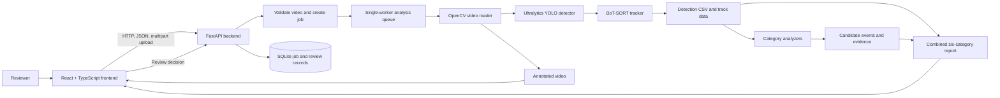

# RoadSentinel presentation and viva preparation guide

This guide describes the implementation and recorded checks in this repository.
Use “candidate” or “risk signal” for automated outputs; do not describe them as
confirmed violations. The source of truth for detailed design is
[ARCHITECTURE.md](./ARCHITECTURE.md), and the runnable walkthrough is
[DEMO_GUIDE.md](./DEMO_GUIDE.md).

## 1. Project at a glance

**RoadSentinel is a local video-analysis and human-review prototype.** A user
uploads dashcam or CCTV footage through a React web interface. A FastAPI
backend validates the video, runs a road-object detector and tracker, saves
annotated playback and event evidence, and returns a report with six category
statuses. Some categories use heuristics or optional calibration; some require
models that are not generally available. The system helps a reviewer locate
moments in footage; it is not an autonomous enforcement system.

### Project abstract

RoadSentinel is a local web application for reviewing road-scene video. It
combines a React and TypeScript frontend with a FastAPI backend. After upload
validation, an Ultralytics YOLO model detects supported road-object classes
and BoT-SORT associates detections across frames. The backend records
detections and tracks, produces annotated video and timestamped evidence, and
generates a report covering six traffic-safety categories. The report
distinguishes candidate events, no candidates, missing calibration,
unavailable analysis, and processing failures. The general IDD detector
recognizes road objects rather than the six violations. Triple-riding and
pedestrian-interaction checks are experimental image-space heuristics;
parking and wrong-way checks require camera calibration; helmet analysis
requires a compatible specialist model; and goods-vehicle load-risk analysis
is unavailable. A verified sample run processed 1,022 frames, generated
3,902 detection rows and 139 track IDs, and returned all six category
statuses. These processing counts demonstrate operation on that clip, not
violation accuracy or generalization. RoadSentinel is therefore a human-review
aid, and its outputs require inspection of the original footage.

### Problem statement

Finding relevant moments in long road-camera recordings can require
time-consuming manual review. Object detections alone do not explain behavior
or determine whether a legal violation occurred. RoadSentinel investigates a
workflow that uses detection, tracking, candidate rules, timestamps, and
evidence to help a person inspect video more efficiently while making
uncertainty and missing capabilities visible.

### Objectives

1. Accept and validate local road-scene videos.
2. Detect and track object classes supported by the configured checkpoint.
3. Generate annotated playback, detection exports, and timestamped evidence.
4. Run selected event analyses only when their required inputs, model, or
   calibration are available.
5. Show a report state for each of the six requested categories.
6. Allow a human reviewer to inspect evidence and record a decision.
7. Communicate limitations rather than treating missing analysis as a
   negative finding.

## 2. Existing and proposed systems

### Existing workflow

In a basic manual workflow, a reviewer watches a recording and searches for
relevant road users or events. A general-purpose object detector can add
bounding boxes, but it does not, by itself, determine whether a road user
violated a rule. Manual review remains necessary to interpret context.

### Proposed RoadSentinel workflow

RoadSentinel adds a local browser dashboard, video validation and job status,
object detection and tracking, selected candidate-event analyses, timestamped
evidence, a six-category report, and reviewer decisions. It does not remove
the reviewer: the category logic is either incomplete, heuristic, dependent
on calibration, or dependent on an optional specialist model.

## 3. Architecture

### Main components

- **Frontend:** `frontend/src/App.tsx` handles dashboard navigation, upload,
  polling, video review, and calibration interactions. The category report is
  in `frontend/src/components/VideoJobReport.tsx`.
- **API and orchestration:** `api.py` exposes health, upload, job, report,
  evidence, calibration, export, and reviewer-decision routes.
- **Computer vision:** OpenCV reads/writes video; Ultralytics loads the
  configured YOLO checkpoint; BoT-SORT is the default tracker.
- **Analyzers:** `tools/roadsentinel_*_analyzer.py` contains tracked-object
  observations and category-specific candidate logic.
- **Persistence:** SQLite stores job and reviewer state; CSV, JSON, videos,
  and evidence images are written to local output directories.

The verified demonstration configuration uses backend port **8766** and
frontend port **5174** because existing RoadSentinel processes occupy 8765 and
5173 on the test machine. The frontend explicitly targets the backend on
8766. See [README.md](../README.md) for startup commands.

## 4. End-to-end video processing pipeline

1. **Select and upload:** The browser sends the video as multipart form data.
2. **Validate:** The API checks the extension, size limit (1 GB), model and
   configuration readiness, and whether OpenCV can open/decode the video.
   The backend creates its own job filename rather than trusting a supplied
   path.
3. **Queue:** The job is persisted and scheduled. A single-worker executor
   serializes video analysis so concurrent jobs do not compete for the model
   and GPU.
4. **Read frames:** OpenCV obtains video dimensions, frame rate, and frames.
5. **Detect and track:** YOLO produces class, confidence, and bounding-box
   detections. `model.track` invokes the configured tracker (BoT-SORT by
   default) to associate detections over time.
6. **Save observations:** The backend records frame number, timestamp,
   class, confidence, box coordinates, and track ID when available. It draws
   detection annotations and writes a processed video.
7. **Analyze candidates:** Track data is passed to the available general,
   helmet, triple-riding, and pedestrian-interaction logic. Parking and
   wrong-way analysis run after the user supplies calibration. Load-risk
   analysis is unavailable.
8. **Create evidence and report:** Candidate frames are saved as evidence.
   The report combines event records with one of six per-category statuses.
9. **Review:** The browser can show the annotated video, event timestamp,
   evidence, and review controls. A reviewer decision is stored separately
   from the detector output.

The timestamp is derived from the video frame index and frame rate. The
recorded sample had 1,022 frames at 30 FPS. This is a pipeline example, not a
claim that every possible codec, frame rate, or video has been tested.

## 5. YOLO, IDD dataset, and model evaluation

### YOLO in this project

YOLO is a family of object-detection models designed to predict object
locations and classes in an image in a single inference pipeline. Here,
YOLO does not directly output “illegal parking” or “wrong-way.” It outputs
the object classes represented in the checkpoint, with bounding boxes and
detection confidence scores. RoadSentinel uses those outputs as inputs to
tracking and category rules.

The configured baseline checkpoint is the YOLOv8n model at
`D:\RoadSentinel-Datasets\training-runs\idd_yolov8n_full\weights\best.pt`.
The original checkpoint is kept outside the repository. The backend records
the model path/name, class mapping, selected device, and inference settings
with a job when available. CUDA is selected when PyTorch reports it
available; otherwise inference uses CPU.

### IDD data used

IDD refers to the India Driving Dataset, a road-scene dataset for Indian
driving conditions. The processed IDD/YOLO dataset used by this project is
maintained outside the repository at
`D:\RoadSentinel-Datasets\processed\IDD_YOLO`, with YAML at
`D:\RoadSentinel-Datasets\processed\IDD_YOLO\idd.yaml`. The checkpoint's
recorded 15 object classes are motorcycle, rider, car, person, autorickshaw,
truck, vehicle fallback, bus, traffic sign, animal, traffic light, bicycle,
caravan, train, and trailer.

Dataset image/split counts, preprocessing manifest, source citation, and
redistribution/license evidence are not captured in this repository. Do not
invent those details; retrieve them from the dataset provenance before
including them in a formal report. The class list also does not contain
ground-truth labels for the six violation categories.

### Metrics and how to explain them

Saved baseline dataset-validation metrics are:

| Metric | Baseline value | Meaning |
|---|---:|---|
| Precision | 0.61192 | Of the evaluated positive object detections, the fraction that were correct under that evaluation setup. |
| Recall | 0.26038 | Of the annotated target objects, the fraction detected under that setup. |
| mAP@0.5 | 0.28612 | Mean class average precision using IoU 0.5 as the match threshold. |
| mAP@0.5:0.95 | 0.18102 | Mean AP averaged over IoU thresholds 0.50 through 0.95. |

These are object-detection validation metrics, not accuracy for helmet,
parking, overloading, pedestrian risk, triple riding, or wrong-way behavior.
They are not a guarantee of performance on a new camera or location. Saved
class AP values and training notes are in
[ACADEMIC_PRESENTATION.md](./ACADEMIC_PRESENTATION.md).

An incomplete fine-tune has saved metrics modestly above the baseline, but
its run stopped at 11 of 50 planned epochs and its configuration differs.
That is not a controlled comparison, so the baseline was not replaced.

## 6. Tracking and event analysis

Object detection answers “what and where in this frame?” Tracking attempts to
answer “which detections in neighboring frames likely belong to the same
object?” BoT-SORT provides track IDs that allow the application to estimate
motion and repeated observations. An ID can switch or disappear because of
occlusion, overlap, low image quality, or missed detections. A track ID is
not proof that an identity association is correct.

Event analyzers use class labels, bounding boxes, frame/time values, track
IDs, confidence thresholds, and—in some categories—user-drawn calibration.
They generate candidate records and evidence, not legal determinations.
“No events” means the configured rule did not produce a candidate; it does not
mean that the video contains no violation.

### Six-category implementation status

| Category | Actual implementation | Viva-safe status |
|---|---|---|
| Helmetless riding | Separate optional detector must expose rider, with-helmet, and without-helmet classes. It spatially associates helmet-state boxes with specialist rider tracks and requires matching same-frame primary-detector `rider` boxes over repeated observations, a minimum duration, and a minimum ratio. A missing helmet box is not treated as proof of no helmet. | **Implemented conditionally; replay-tested but not ground-truth validated.** Requires a compatible specialist checkpoint. In the saved target-video replay one corroborated candidate remained; five candidates in a separate clip were rejected. The general IDD detector cannot infer helmet state. |
| Triple riding | Experimental rule associates at least three distinct rider-class tracks with one motorcycle using box geometry. It suppresses near-duplicate rider boxes and requires repeated candidate frames and duration (defaults: five frames and 0.75 seconds). | **Experimental heuristic; not positively validated end-to-end.** Nearby riders, overlaps, and tracking errors can create false results. |
| Illegal parking | After the user draws a normalized restricted-zone polygon, the analyzer looks for a vehicle's bottom-center within the region for a stationary duration. It checks normalized center speed/spread and splits tracks across long observation gaps. | **Implemented with calibration; not validated with a positive calibrated end-to-end result.** A stationary vehicle inside a drawn zone is not proof of illegality; signs and legal context are not interpreted. |
| Overloaded goods vehicle | The report includes a category and explains that no validated cargo-risk detector is configured. Truck detection is not load measurement. | **Unavailable.** There is no working overload inference to demonstrate. |
| Unsafe pedestrian crossing/interaction | Experimental heuristic pairs person and vehicle tracks in shared frames, requires person-track displacement of at least 0.4 median person-box heights, decreasing image-space separation, and final proximity. The person is the event subject; the vehicle is separate context. | **Experimental heuristic; replay-tested but not ground-truth validated.** The saved target-video replay reduced candidates from 8 to 2. Pixel distances are not physical distance or time-to-collision, and this is not crossing-intent classification. |
| Wrong-way movement | After the user draws a road polygon and expected-direction arrow, the analyzer examines track movement in that region and compares its direction with the configured vector. It uses duration, displacement, and opposite-alignment thresholds. | **Implemented with calibration; not validated with a positive calibrated end-to-end result.** Perspective and one image-space arrow can misrepresent actual road direction. |

The report also communicates `analysis_failed`, `analysis_unavailable`,
`not_configured`, `no_events`, `events_detected`, or incomplete states as
appropriate. The tested `correct video.mp4` produced all six categories, but
that is not equivalent to testing six positive detections.

## 7. Technology stack

| Technology | Role |
|---|---|
| Python | Backend language and analysis orchestration |
| FastAPI / Uvicorn | HTTP API, upload endpoints, health, reports, and local server |
| OpenCV | Video decoding/encoding, frame access, annotations, and evidence images |
| PyTorch / Ultralytics YOLO | Object-detector runtime and inference |
| BoT-SORT | Multi-object tracking configured through Ultralytics |
| SQLite | Local job metadata and reviewer state |
| CSV / JSON | Detection, event, and report data exchange |
| React / TypeScript | User interface and typed client-side logic |
| Vite | Frontend development server and production bundler |
| Python `unittest` | Backend/analyzer automated tests |

## 8. Methodology and development workflow

The implementation follows a staged video-review workflow:

1. Prepare an IDD-derived object detector and inspect its class map.
2. Accept local video and validate its format/readability.
3. Run frame-level object detection and multi-object tracking.
4. Store detections and derive track-level observations.
5. Apply only the category rules supported by current model/configuration.
6. Attach frame evidence and timestamps to review candidates.
7. Aggregate job state, category state, and candidate records into a report.
8. Let the reviewer inspect the video and optionally record a decision.
9. Test code paths with automated tests and exercise the real upload flow with
   an available clip.

The available 55-test backend suite tests API and analyzer behavior; it does
not establish accuracy on a labeled real-world violation dataset. The
frontend production build checks TypeScript compilation and bundling; it is
not a substitute for testing all browser behaviors or all analyzers.

## 9. Recorded results

In a verified end-to-end run, `correct video.mp4` completed **1,022 of 1,022
frames**, generated **3,902 detection rows**, **139 unique track IDs**, **22
raw candidate-event records**, and **22 evidence images**. Its report showed
all six categories. The report statuses for that run were: helmetless
`no_events` (specialist configured on that run), triple riding `no_events`,
parking `not_configured`, goods-vehicle risk `analysis_unavailable`,
pedestrian interaction `no_events`, and wrong-way `not_configured`.

A separate `road_video.mp4` report contained 89 pedestrian-interaction
candidates requiring review. These were outputs of an experimental heuristic,
not 89 confirmed unsafe crossings. Neither clip had independently annotated
ground truth to measure category false positives and false negatives.

The backend suite had **55 passing tests** and the frontend production build
passed in the recorded validation. These are engineering checks, not a
statistical model-accuracy evaluation. Re-run them on the submission machine
if the code or environment changes.

## 10. Limitations and future scope

### Current limitations

- Object detector errors and tracker ID switches propagate to event analysis.
- Dataset validation metrics do not measure category-level violation accuracy.
- No independent expert-labeled traffic-violation test set is documented.
- Helmet detection depends on an external specialist checkpoint and has no
  independent accuracy benchmark.
- Triple-riding and pedestrian-interaction rules are experimental heuristics.
- Parking and wrong-way analysis depend on user calibration for each camera.
- Goods-vehicle load-risk analysis is unavailable; visual vehicle class is
  not payload weight.
- Image-space measurements are affected by perspective and are not calibrated
  physical distance, speed, or time-to-collision.
- Analysis is local and serialized. Interrupted jobs are not automatically
  resumed.
- Dataset counts, full provenance, and usage/license evidence must be verified
  from the dataset source before academic redistribution.

### Future work

1. Build a licensed, diverse, expert-annotated dataset for each violation
   category and report category-level precision, recall, and false-positive/
   false-negative analysis.
2. Evaluate the specialist helmet model against held-out footage, including
   different viewpoints, lighting, occlusion, and helmet types.
3. Add calibrated geometry where physical distance or speed is required.
4. Collect and validate cargo/load evidence with an appropriate sensing
   method rather than inferring legal weight from a truck box.
5. Measure performance across representative hardware, cameras, resolutions,
   and weather before making deployment claims.
6. Add robust recovery, monitoring, and data-retention controls for a
   production setting.

## 11. Demonstration script

### Suggested 5–7 minute walkthrough

**1. Introduction (30 seconds)**  
“RoadSentinel is a local video-review prototype. It detects and tracks
supported road objects, proposes review moments, and records evidence. It
does not automatically prove or enforce violations.”

**2. Problem and objective (30 seconds)**  
Explain that locating moments in long recordings can be tedious. The aim is
to help a reviewer navigate footage with detections, timestamps, evidence,
and explicit analysis status.

**3. Architecture (45 seconds)**  
Show the browser frontend, FastAPI backend, OpenCV input/output, YOLO detector,
BoT-SORT tracker, analyzers, local reports, and reviewer. Mention that the
backend does the inference and stores runtime files locally.

**4. Upload and processing (1–2 minutes)**  
Use an authorized sample from `samples/`. Show that the API is connected,
select the video, start upload, and explain progress. On the verified
`correct video.mp4` run, 1,022 frames were processed with 3,902 detection
rows, 139 tracks, and 22 evidence images. These are processing counters, not
accuracy scores.

**5. Video and evidence review (1–2 minutes)**  
Show annotated playback and detector class information. Select a timestamped
candidate, inspect its evidence, and seek the video. Explain that track IDs,
boxes, confidence, and image-space geometry can be wrong and require source
video review.

**6. Six category report (1–2 minutes)**  
Walk through the actual states displayed. Explain the optional helmet
specialist requirement, triple-riding heuristic, parking calibration,
unavailable load analysis, pedestrian-interaction heuristic, and wrong-way
calibration. Do not promise positive detections; explain that `no_events`
does not prove absence.

**7. Close (30 seconds)**  
Summarize the usefulness as reviewer assistance, then state the limitations
and next step: evaluate each category against representative expert-labeled
footage.

### Pre-demo checklist

- Start the backend on `127.0.0.1:8766` and check `/health`.
- Start the frontend on `127.0.0.1:5174`; confirm “API connected.”
- Verify model readiness and available disk space.
- Use a short clip with permission to demonstrate.
- Keep the sample copy safe; do not edit or fabricate output.
- Do not clear runtime outputs or restart a processing job during the demo.

## 12. Likely viva questions and answers

### Project and design

**Q1. What is RoadSentinel?**  
It is a local road-video review application that detects and tracks supported
objects, generates candidate events and evidence, and presents a report for
human review.

**Q2. What problem does it address?**  
Manual review of long traffic videos can take time. The system helps surface
objects and candidate moments with timestamps so a reviewer can navigate
footage more efficiently.

**Q3. Is RoadSentinel an automatic enforcement system?**  
No. Its outputs are observations or review candidates. The system does not
make legal findings, and a human must inspect the original footage.

**Q4. What is the main contribution?**  
The integration of local upload, detection, tracking, selected candidate
analysis, evidence, and a report that exposes category availability and
uncertainty in one review workflow.

**Q5. Why use a web application?**  
A browser interface makes upload, progress, playback, evidence, and reports
accessible without requiring the reviewer to operate the video pipeline from
a command line.

### YOLO, datasets, and evaluation

**Q6. What does YOLO do here?**  
It detects supported object classes in frames and returns boxes and
confidence scores. It does not directly classify the six legal/safety
categories.

**Q7. What is the IDD dataset used for?**  
The project uses a processed IDD/YOLO road-object dataset and a checkpoint
trained/validated against it. Its recorded class map contains 15 object
classes. The exact dataset counts and license details are not documented in
this repository and should be confirmed from the source.

**Q8. Why does the IDD model not solve all six categories?**  
Its labels represent road objects such as riders, motorcycles, people, and
trucks. Labels such as illegal parking or overloading require behavior,
context, measurements, or category-specific annotations that are not
provided by those object classes.

**Q9. What is precision?**  
Precision is the proportion of predicted positives that are correct under a
defined evaluation setup. Low precision means more false-positive detections.

**Q10. What is recall?**  
Recall is the proportion of ground-truth positives that the model detected.
Low recall means more missed objects/events.

**Q11. What is mAP?**  
Mean Average Precision averages precision-recall performance over classes.
The IoU threshold defines how much a predicted box must overlap the labeled
box to count as a match. mAP here measures object detection on the saved
validation setup, not violation detection.

**Q12. What is confidence? Is 0.8 an 80% chance of a violation?**  
No. It is the detector's confidence output for a class/box under that model.
It is not automatically calibrated as a probability, and it is not the
probability that a legal violation occurred.

**Q13. How do you handle false positives and false negatives?**  
The report calls outputs candidates, preserves evidence, and requires human
review. A false positive is an incorrect candidate; a false negative is an
event the system misses. Quantifying either requires independently labeled
test footage, which is not available for all six categories.

**Q14. Why not claim 100% accuracy?**  
There is no evidence for that claim. The object detector has non-perfect
validation metrics, the heuristics can be wrong, and no comprehensive,
independently labeled violation test set has been evaluated.

### Tracking, events, and computer vision

**Q15. Why is tracking needed after detection?**  
Detection is frame-by-frame. Tracking associates objects over time, enabling
the application to reason about persistence and movement and to link evidence
to a track.

**Q16. What is BoT-SORT?**  
It is the configured multi-object tracking algorithm used to associate
detections across video frames. Track IDs can still switch or be lost,
especially with occlusion or crowded scenes.

**Q17. How are timestamps calculated?**  
They are based on the frame index and source frame rate. The report stores
timestamp/frame information so evidence and playback can be correlated.

**Q18. What is an image-space measurement?**  
It is measured in pixels in the image plane. Without camera calibration and
scene geometry, pixels cannot be interpreted as real-world meters or
collision time.

**Q19. How does triple-riding analysis work?**  
The heuristic looks for at least three distinct rider-class tracks
geometrically associated with one motorcycle over repeated frames and a
minimum duration. It can confuse nearby people, overlap, or tracking errors,
so it creates only a review candidate.

**Q20. How does pedestrian-interaction analysis work?**  
It compares person and vehicle tracks sharing frames, measures image-space
separation, and looks for an approaching pair that ends close in the image.
It does not establish crossing intent, physical distance, or time-to-collision.

**Q21. How does the parking analyzer work?**  
A reviewer draws a restricted-zone polygon. The analyzer checks whether a
vehicle's bottom-center remains inside and appears stationary for a duration.
It does not read parking signs or determine whether the stop is legally
prohibited.

**Q22. How does wrong-way analysis work?**  
A reviewer draws the road region and an expected direction. The analyzer
compares a track's image-space movement within that region with the configured
direction and reports opposite-direction candidates. Calibration and
perspective can affect the result.

### Backend, frontend, and system behavior

**Q23. Why FastAPI?**  
FastAPI provides typed HTTP endpoints for health, uploads, job status,
reports, calibration, and review actions. Uvicorn runs the ASGI application.

**Q24. What does React do?**  
React renders the dashboard and manages user interactions such as selecting a
video, polling job status, opening evidence, and reviewing the report.
TypeScript adds static type checks to frontend code.

**Q25. How does the UI learn processing progress?**  
The backend persists job status/progress, and the frontend periodically polls
the job endpoint to update the display.

**Q26. Why is there a single-worker analysis queue?**  
It serializes expensive model inference, avoids concurrent jobs contending
for GPU/model state, and allows the API to handle status requests while a
video is being processed.

**Q27. What if CUDA is unavailable?**  
The backend chooses CPU when PyTorch reports no CUDA GPU. This keeps the
pipeline available when possible, though inference may be slower.

**Q28. Where is data stored?**  
Job state and reviewer decisions are stored locally in SQLite. Videos,
detection files, reports, and evidence are written under local output
directories. They are not automatically a durable or backed-up archive.

**Q29. What happens if a job is interrupted?**  
The current application marks interrupted/in-progress jobs failed after
restart; it does not automatically resume their frame processing.

### Status, limitations, and evaluation

**Q30. What does `no_events` mean?**  
It means the configured analysis completed but none of its rules emitted a
candidate. It is not proof that the video contains no violation.

**Q31. What is the difference between unavailable and not configured?**  
Unavailable means a required capability/model is absent. Not configured means
the analyzer requires input such as a camera-specific polygon/direction that
has not been supplied.

**Q32. Which category is unavailable?**  
Goods-vehicle load risk. The system does not have a validated cargo-risk
detector or a weight measurement, so truck detection cannot establish
overloading.

**Q33. Which categories are experimental?**  
Triple riding and pedestrian interaction use image-space spatial/temporal
heuristics. They can generate review candidates but have not been validated
against ground truth.

**Q34. Were all six categories tested?**  
All six category entries and their report/status integration were observed on
a real processed video. That did not validate six positive detection
scenarios. Positive end-to-end category validation was not completed for all
six, and the load-risk capability is unavailable.

**Q35. What evidence supports the demo claim?**  
One recorded run processed 1,022 frames and produced 3,902 detection rows,
139 track IDs, 22 raw candidate-event records, and 22 evidence images. These
counters show that this pipeline run completed; they do not prove accuracy.

**Q36. What do the 58 backend tests prove?**  
They verify tested software behaviors and analyzer/API paths under the test
inputs. They do not prove real-world detection accuracy or correct behavior
for every camera and violation.

**Q37. What is required to validate a category properly?**  
Representative licensed videos with expert-labeled events, a defined event
matching rule (including time tolerance), held-out evaluation, and
category-level precision, recall, false-positive, and false-negative
reporting.

**Q38. What are the next steps?**  
Collect and license representative data, validate each category separately,
improve calibration and specialist models, measure performance across
cameras/hardware, and strengthen production monitoring and data retention.

## 13. Short real-world usefulness explanation

“RoadSentinel can help a traffic reviewer search long recordings by surfacing
detected road users, tracked movement, timestamps, and evidence in a single
report. It can reduce the effort of locating moments that deserve attention.
It is not a substitute for a trained reviewer: some analyses are experimental
or unavailable, and every candidate must be checked against the source
video.”

## 14. Claims to avoid in the presentation

- Do not say that all six violation detectors are fully implemented or
  positively validated.
- Do not call object-detection mAP “violation accuracy.”
- Do not describe a category's `no_events` status as proof that no violation
  occurred.
- Do not claim that pixel separation is physical distance or time-to-collision.
- Do not claim that a detected truck is overloaded.
- Do not promise the same event counts on every upload.
- Do not claim that the system replaces a human reviewer or makes legal
  decisions.
